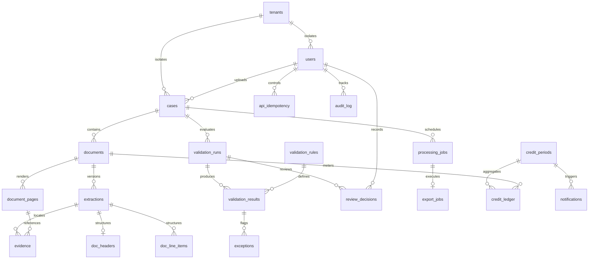

# Model Data dan Skema Relasional
Tujuan file ini: mendefinisikan skema relasional lengkap, DDL SQL PostgreSQL produksi, ERD, dan strategi partisi volume tinggi.
Dibaca oleh / kapan dipakai: tim backend/database arsitek saat merancang migrasi Alembic, transaksi, dan pipeline penyimpanan bukti.

## Konvensi skema
**Berdasarkan Usulan D-009/D-010/D-011/D-013.** Basis data menggunakan **PostgreSQL 16**.
1. **Identitas & Kunci Primer:** Setiap tabel menggunakan `id UUID PRIMARY KEY DEFAULT gen_random_uuid()` dan `created_at TIMESTAMPTZ NOT NULL DEFAULT clock_timestamp()`.
2. **Isolasi Multi-Tenant:** Setiap tabel operasional memiliki kolom `tenant_id UUID NOT NULL REFERENCES tenants(id) ON DELETE RESTRICT`. Seluruh foreign key antar entitas anak WAJIB menggunakan komposit `(tenant_id, foreign_id)` yang merujuk pada `UNIQUE (tenant_id, id)` tabel induk untuk menjamin ketatnya batas isolasi tenant.
3. **Presisi Finansial & Kuantitas:** Kolom moneter dan kuantitas menggunakan tipe data exact `NUMERIC(24,6)` untuk mencegah rounding error floating point. DILARANG menggunakan tipe data `FLOAT` atau `DOUBLE PRECISION`.
4. **Waktu & Zona Waktu:** Seluruh kolom timestamp bertipe `TIMESTAMPTZ` dan disimpan dalam standar UTC.
5. **Integritas Referensial & Immutability:** Tidak ada `CASCADE DELETE`. Riwayat ekstraksi (`extractions`), bukti (`evidence`), run validasi (`validation_runs`), keputusan manusia (`review_decisions`), buku besar kredit (`credit_ledger`), dan log audit (`audit_log`) bersifat **IMMUTABLE** (hanya append-only, dilarang UPDATE/DELETE).
6. **Strategi Soft Delete:** Entitas `cases`, `documents`, dan `users` menerapkan penghapusan lunak melalui kolom `deleted_at TIMESTAMPTZ NULL`. Query standar aplikasi WAJIB menyertakan klausul `WHERE deleted_at IS NULL`.

---

## Tabel dan kolom

### 1. DDL SQL PostgreSQL Lengkap

```sql
-- Ekstensi PostgreSQL yang Diperlukan
CREATE EXTENSION IF NOT EXISTS "pgcrypto";

-- ENUM Types untuk Integritas State Machine
CREATE TYPE deployment_mode_enum AS ENUM ('managed', 'onprem');
CREATE TYPE user_role_enum AS ENUM ('STAFF', 'APPROVER', 'ADMIN', 'OPS');
CREATE TYPE case_proc_status_enum AS ENUM ('UPLOADED', 'PROCESSING', 'EXTRACTED', 'VALIDATED', 'FAILED');
CREATE TYPE validation_status_enum AS ENUM ('MATCHED', 'NEEDS_REVIEW', 'INCOMPLETE', 'DUPLICATE_SUSPECT');
CREATE TYPE doc_type_enum AS ENUM ('INVOICE', 'PO', 'DELIVERY_NOTE', 'GOODS_RECEIPT', 'BAST', 'OTHER');
CREATE TYPE doc_state_enum AS ENUM ('QUARANTINED', 'ACCEPTED', 'PROCESSING', 'READY', 'FAILED');
CREATE TYPE job_kind_enum AS ENUM ('INGEST', 'PROCESS', 'REPROCESS', 'VALIDATE', 'EXPORT');
CREATE TYPE job_status_enum AS ENUM ('QUEUED', 'RUNNING', 'SUCCEEDED', 'FAILED');
CREATE TYPE rule_severity_enum AS ENUM ('INFO', 'WARN', 'ERROR');
CREATE TYPE rule_outcome_enum AS ENUM ('PASS', 'FAIL', 'SKIPPED', 'INCOMPLETE');
CREATE TYPE exception_type_enum AS ENUM ('MISMATCH', 'DUPLICATE_SUSPECT', 'MISSING_INFO');
CREATE TYPE exception_state_enum AS ENUM ('OPEN', 'IN_REVIEW', 'RESOLVED');
CREATE TYPE human_decision_enum AS ENUM ('ACCEPTED', 'REJECTED', 'NEEDS_CLARIFICATION');
CREATE TYPE export_format_enum AS ENUM ('CSV', 'XLSX');
CREATE TYPE export_status_enum AS ENUM ('QUEUED', 'RUNNING', 'READY', 'FAILED', 'EXPIRED');
CREATE TYPE credit_period_state_enum AS ENUM ('OPEN', 'CLOSED');
CREATE TYPE credit_entry_type_enum AS ENUM ('CHARGE', 'ADJUSTMENT');
CREATE TYPE notif_type_enum AS ENUM ('NEAR_QUOTA', 'QUOTA_REACHED', 'QUOTA_EXCEEDED');
CREATE TYPE actor_type_enum AS ENUM ('HUMAN', 'SYSTEM');

-- 1. TABEL TENANTS (Multi-tenant Root)
CREATE TABLE tenants (
    id UUID PRIMARY KEY DEFAULT gen_random_uuid(),
    name VARCHAR(255) NOT NULL,
    deployment_mode deployment_mode_enum NOT NULL DEFAULT 'managed',
    active BOOLEAN NOT NULL DEFAULT true,
    created_at TIMESTAMPTZ NOT NULL DEFAULT clock_timestamp(),
    updated_at TIMESTAMPTZ NOT NULL DEFAULT clock_timestamp(),
    CONSTRAINT uq_tenants_name UNIQUE (name)
);

-- 2. TABEL USERS (Pengguna & Peran)
CREATE TABLE users (
    id UUID PRIMARY KEY DEFAULT gen_random_uuid(),
    tenant_id UUID NOT NULL REFERENCES tenants(id) ON DELETE RESTRICT,
    subject VARCHAR(255) NOT NULL, -- Subject ID dari AuthProvider/SSO
    name VARCHAR(255) NOT NULL,
    email VARCHAR(255) NOT NULL,
    role user_role_enum NOT NULL,
    active BOOLEAN NOT NULL DEFAULT true,
    password_hash VARCHAR(255) NULL, -- Hanya untuk adapter auth lokal dev
    version INTEGER NOT NULL DEFAULT 1 CHECK (version > 0),
    created_at TIMESTAMPTZ NOT NULL DEFAULT clock_timestamp(),
    updated_at TIMESTAMPTZ NOT NULL DEFAULT clock_timestamp(),
    deleted_at TIMESTAMPTZ NULL,
    CONSTRAINT uq_users_tenant_id_id UNIQUE (tenant_id, id),
    CONSTRAINT uq_users_tenant_subject UNIQUE (tenant_id, subject),
    CONSTRAINT uq_users_tenant_email UNIQUE (tenant_id, email)
);
CREATE INDEX idx_users_tenant_role ON users (tenant_id, role) WHERE deleted_at IS NULL;

-- 3. TABEL CASES (Bundel Dokumen Faktur)
CREATE TABLE cases (
    id UUID PRIMARY KEY DEFAULT gen_random_uuid(),
    tenant_id UUID NOT NULL REFERENCES tenants(id) ON DELETE RESTRICT,
    case_number VARCHAR(64) NOT NULL,
    uploaded_by UUID NOT NULL,
    processing_status case_proc_status_enum NOT NULL DEFAULT 'UPLOADED',
    validation_status validation_status_enum NULL,
    total_pages INTEGER NOT NULL DEFAULT 0 CHECK (total_pages >= 0),
    current_run_id UUID NULL, -- Diisi setelah validation_run terbentuk
    version INTEGER NOT NULL DEFAULT 1 CHECK (version > 0),
    created_at TIMESTAMPTZ NOT NULL DEFAULT clock_timestamp(),
    updated_at TIMESTAMPTZ NOT NULL DEFAULT clock_timestamp(),
    deleted_at TIMESTAMPTZ NULL,
    CONSTRAINT uq_cases_tenant_id_id UNIQUE (tenant_id, id),
    CONSTRAINT uq_cases_tenant_number UNIQUE (tenant_id, case_number),
    CONSTRAINT fk_cases_uploaded_by FOREIGN KEY (tenant_id, uploaded_by) REFERENCES users(tenant_id, id) ON DELETE RESTRICT
);
CREATE INDEX idx_cases_tenant_status ON cases (tenant_id, processing_status, validation_status) WHERE deleted_at IS NULL;
CREATE INDEX idx_cases_created_at ON cases (tenant_id, created_at DESC) WHERE deleted_at IS NULL;

-- 4. TABEL DOCUMENTS (Berkas Fisik)
CREATE TABLE documents (
    id UUID PRIMARY KEY DEFAULT gen_random_uuid(),
    tenant_id UUID NOT NULL REFERENCES tenants(id) ON DELETE RESTRICT,
    case_id UUID NOT NULL,
    uploaded_by UUID NOT NULL,
    doc_type doc_type_enum NOT NULL DEFAULT 'OTHER',
    object_key VARCHAR(512) NOT NULL,
    filename VARCHAR(255) NOT NULL,
    mime_type VARCHAR(128) NOT NULL,
    sha256 CHAR(64) NOT NULL,
    page_count INTEGER NOT NULL DEFAULT 0 CHECK (page_count >= 0),
    state doc_state_enum NOT NULL DEFAULT 'QUARANTINED',
    error_code VARCHAR(64) NULL,
    version INTEGER NOT NULL DEFAULT 1 CHECK (version > 0),
    created_at TIMESTAMPTZ NOT NULL DEFAULT clock_timestamp(),
    updated_at TIMESTAMPTZ NOT NULL DEFAULT clock_timestamp(),
    deleted_at TIMESTAMPTZ NULL,
    CONSTRAINT uq_documents_tenant_id_id UNIQUE (tenant_id, id),
    CONSTRAINT uq_documents_tenant_object_key UNIQUE (tenant_id, object_key),
    CONSTRAINT fk_documents_case FOREIGN KEY (tenant_id, case_id) REFERENCES cases(tenant_id, id) ON DELETE RESTRICT,
    CONSTRAINT fk_documents_uploaded_by FOREIGN KEY (tenant_id, uploaded_by) REFERENCES users(tenant_id, id) ON DELETE RESTRICT
);
CREATE INDEX idx_documents_tenant_case ON documents (tenant_id, case_id) WHERE deleted_at IS NULL;
CREATE INDEX idx_documents_tenant_sha256 ON documents (tenant_id, sha256);

-- 5. TABEL DOCUMENT_PAGES (Halaman Render & OCR - Siap Partisi Bulanan)
CREATE TABLE document_pages (
    id UUID NOT NULL DEFAULT gen_random_uuid(),
    tenant_id UUID NOT NULL REFERENCES tenants(id) ON DELETE RESTRICT,
    document_id UUID NOT NULL,
    page_number INTEGER NOT NULL CHECK (page_number > 0),
    image_key VARCHAR(512) NOT NULL,
    width INTEGER NOT NULL CHECK (width > 0),
    height INTEGER NOT NULL CHECK (height > 0),
    ocr_text_encrypted TEXT NULL, -- Teks OCR terenkripsi AES-256
    created_at TIMESTAMPTZ NOT NULL DEFAULT clock_timestamp(),
    CONSTRAINT pk_document_pages PRIMARY KEY (id, created_at),
    CONSTRAINT uq_doc_pages_tenant_page UNIQUE (tenant_id, document_id, page_number, created_at),
    CONSTRAINT uq_doc_pages_lookup UNIQUE (tenant_id, id, created_at)
) PARTITION BY RANGE (created_at);

-- 6. TABEL PROCESSING_JOBS (Outbox Durable Pipeline)
CREATE TABLE processing_jobs (
    id UUID PRIMARY KEY DEFAULT gen_random_uuid(),
    tenant_id UUID NOT NULL REFERENCES tenants(id) ON DELETE RESTRICT,
    case_id UUID NOT NULL,
    document_id UUID NULL,
    kind job_kind_enum NOT NULL,
    status job_status_enum NOT NULL DEFAULT 'QUEUED',
    attempt INTEGER NOT NULL DEFAULT 0 CHECK (attempt >= 0),
    idempotency_key VARCHAR(255) NOT NULL,
    policy_version VARCHAR(64) NULL,
    failure_code VARCHAR(64) NULL,
    available_at TIMESTAMPTZ NOT NULL DEFAULT clock_timestamp(),
    heartbeat_at TIMESTAMPTZ NULL,
    completed_at TIMESTAMPTZ NULL,
    created_at TIMESTAMPTZ NOT NULL DEFAULT clock_timestamp(),
    updated_at TIMESTAMPTZ NOT NULL DEFAULT clock_timestamp(),
    CONSTRAINT uq_jobs_tenant_id_id UNIQUE (tenant_id, id),
    CONSTRAINT uq_jobs_tenant_idempotency UNIQUE (tenant_id, idempotency_key),
    CONSTRAINT fk_jobs_case FOREIGN KEY (tenant_id, case_id) REFERENCES cases(tenant_id, id) ON DELETE RESTRICT
);
CREATE INDEX idx_jobs_status_available ON processing_jobs (status, available_at) WHERE status IN ('QUEUED', 'RUNNING');

-- 7. TABEL EXTRACTIONS (Hasil AI Per Dokumen)
CREATE TABLE extractions (
    id UUID PRIMARY KEY DEFAULT gen_random_uuid(),
    tenant_id UUID NOT NULL REFERENCES tenants(id) ON DELETE RESTRICT,
    document_id UUID NOT NULL,
    job_id UUID NOT NULL,
    model_id VARCHAR(128) NOT NULL,
    prompt_version VARCHAR(64) NOT NULL,
    schema_version VARCHAR(64) NOT NULL,
    raw_json JSONB NOT NULL,
    quality_flags JSONB NOT NULL DEFAULT '[]'::jsonb,
    extracted_at TIMESTAMPTZ NOT NULL DEFAULT clock_timestamp(),
    created_at TIMESTAMPTZ NOT NULL DEFAULT clock_timestamp(),
    CONSTRAINT uq_extractions_tenant_id_id UNIQUE (tenant_id, id),
    CONSTRAINT uq_extractions_job_doc UNIQUE (tenant_id, job_id, document_id),
    CONSTRAINT fk_extractions_document FOREIGN KEY (tenant_id, document_id) REFERENCES documents(tenant_id, id) ON DELETE RESTRICT,
    CONSTRAINT fk_extractions_job FOREIGN KEY (tenant_id, job_id) REFERENCES processing_jobs(tenant_id, id) ON DELETE RESTRICT
);

-- 8. TABEL DOC_HEADERS (Field Tingkat Dokumen Terstruktur)
CREATE TABLE doc_headers (
    id UUID PRIMARY KEY DEFAULT gen_random_uuid(),
    tenant_id UUID NOT NULL REFERENCES tenants(id) ON DELETE RESTRICT,
    extraction_id UUID NOT NULL,
    vendor_name TEXT NULL,
    vendor_identifier VARCHAR(128) NULL,
    vendor_normalized VARCHAR(255) NULL,
    doc_number VARCHAR(128) NULL,
    normalized_number VARCHAR(128) NULL,
    doc_date DATE NULL,
    currency CHAR(3) NULL,
    subtotal NUMERIC(24,6) NULL,
    tax_amount NUMERIC(24,6) NULL,
    total_amount NUMERIC(24,6) NULL,
    references_json JSONB NOT NULL DEFAULT '{}'::jsonb,
    created_at TIMESTAMPTZ NOT NULL DEFAULT clock_timestamp(),
    CONSTRAINT uq_doc_headers_tenant_id_id UNIQUE (tenant_id, id),
    CONSTRAINT uq_doc_headers_extraction UNIQUE (tenant_id, extraction_id),
    CONSTRAINT fk_doc_headers_extraction FOREIGN KEY (tenant_id, extraction_id) REFERENCES extractions(tenant_id, id) ON DELETE RESTRICT
);
CREATE INDEX idx_headers_duplicate_lookup ON doc_headers (tenant_id, vendor_normalized, normalized_number, doc_date, total_amount);

-- 9. TABEL DOC_LINE_ITEMS (Field Baris Item)
CREATE TABLE doc_line_items (
    id UUID PRIMARY KEY DEFAULT gen_random_uuid(),
    tenant_id UUID NOT NULL REFERENCES tenants(id) ON DELETE RESTRICT,
    extraction_id UUID NOT NULL,
    line_no INTEGER NOT NULL CHECK (line_no > 0),
    description TEXT NULL,
    item_code VARCHAR(128) NULL,
    qty NUMERIC(24,6) NULL,
    uom VARCHAR(32) NULL,
    unit_price NUMERIC(24,6) NULL,
    line_total NUMERIC(24,6) NULL,
    created_at TIMESTAMPTZ NOT NULL DEFAULT clock_timestamp(),
    CONSTRAINT uq_line_items_tenant_id_id UNIQUE (tenant_id, id),
    CONSTRAINT uq_line_items_line_no UNIQUE (tenant_id, extraction_id, line_no),
    CONSTRAINT fk_line_items_extraction FOREIGN KEY (tenant_id, extraction_id) REFERENCES extractions(tenant_id, id) ON DELETE RESTRICT
);

-- 10. TABEL EVIDENCE (Jejak Lokasi Bukti Visual - Siap Partisi Bulanan)
CREATE TABLE evidence (
    id UUID NOT NULL DEFAULT gen_random_uuid(),
    tenant_id UUID NOT NULL REFERENCES tenants(id) ON DELETE RESTRICT,
    extraction_id UUID NOT NULL,
    document_id UUID NOT NULL,
    page_number INTEGER NOT NULL CHECK (page_number > 0),
    field_path VARCHAR(255) NOT NULL,
    value_json JSONB NULL,
    bbox JSONB NULL, -- Format [x0, y0, x1, y1] normalized 0..1
    created_at TIMESTAMPTZ NOT NULL DEFAULT clock_timestamp(),
    CONSTRAINT pk_evidence PRIMARY KEY (id, created_at),
    CONSTRAINT uq_evidence_tenant_id UNIQUE (tenant_id, id, created_at)
) PARTITION BY RANGE (created_at);
CREATE INDEX idx_evidence_extraction ON evidence (tenant_id, extraction_id, field_path);

-- 11. TABEL VALIDATION_RULES (Katalog Rule Terpusat & Parameter)
CREATE TABLE validation_rules (
    id UUID PRIMARY KEY DEFAULT gen_random_uuid(),
    tenant_id UUID NOT NULL REFERENCES tenants(id) ON DELETE RESTRICT,
    code VARCHAR(64) NOT NULL,
    rule_version INTEGER NOT NULL DEFAULT 1 CHECK (rule_version > 0),
    description TEXT NOT NULL,
    params JSONB NOT NULL DEFAULT '{}'::jsonb,
    severity rule_severity_enum NOT NULL DEFAULT 'WARN',
    active BOOLEAN NOT NULL DEFAULT true,
    approved_by UUID NULL,
    change_reason TEXT NOT NULL,
    created_at TIMESTAMPTZ NOT NULL DEFAULT clock_timestamp(),
    CONSTRAINT uq_val_rules_tenant_id_id UNIQUE (tenant_id, id),
    CONSTRAINT uq_val_rules_version UNIQUE (tenant_id, code, rule_version),
    CONSTRAINT fk_val_rules_approved_by FOREIGN KEY (tenant_id, approved_by) REFERENCES users(tenant_id, id) ON DELETE RESTRICT
);

-- 12. TABEL VALIDATION_RUNS (Snapshot Eksekusi Validasi)
CREATE TABLE validation_runs (
    id UUID PRIMARY KEY DEFAULT gen_random_uuid(),
    tenant_id UUID NOT NULL REFERENCES tenants(id) ON DELETE RESTRICT,
    case_id UUID NOT NULL,
    job_id UUID NOT NULL,
    rules_snapshot JSONB NOT NULL,
    extraction_ids JSONB NOT NULL,
    status VARCHAR(32) NOT NULL DEFAULT 'RUNNING',
    overall_status validation_status_enum NULL,
    started_at TIMESTAMPTZ NOT NULL DEFAULT clock_timestamp(),
    finished_at TIMESTAMPTZ NULL,
    created_at TIMESTAMPTZ NOT NULL DEFAULT clock_timestamp(),
    CONSTRAINT uq_val_runs_tenant_id_id UNIQUE (tenant_id, id),
    CONSTRAINT uq_val_runs_job UNIQUE (tenant_id, job_id),
    CONSTRAINT fk_val_runs_case FOREIGN KEY (tenant_id, case_id) REFERENCES cases(tenant_id, id) ON DELETE RESTRICT,
    CONSTRAINT fk_val_runs_job FOREIGN KEY (tenant_id, job_id) REFERENCES processing_jobs(tenant_id, id) ON DELETE RESTRICT
);

-- Hubungkan current_run_id di cases kembali ke validation_runs
ALTER TABLE cases ADD CONSTRAINT fk_cases_current_run FOREIGN KEY (tenant_id, current_run_id) REFERENCES validation_runs(tenant_id, id) ON DELETE SET NULL;

-- 13. TABEL VALIDATION_RESULTS (Hasil Per Aturan)
CREATE TABLE validation_results (
    id UUID PRIMARY KEY DEFAULT gen_random_uuid(),
    tenant_id UUID NOT NULL REFERENCES tenants(id) ON DELETE RESTRICT,
    run_id UUID NOT NULL,
    rule_id UUID NOT NULL,
    outcome rule_outcome_enum NOT NULL,
    reason_code VARCHAR(64) NOT NULL,
    reasoning TEXT NOT NULL,
    computed_values JSONB NOT NULL DEFAULT '{}'::jsonb,
    evidence_ids JSONB NOT NULL DEFAULT '[]'::jsonb,
    created_at TIMESTAMPTZ NOT NULL DEFAULT clock_timestamp(),
    CONSTRAINT uq_val_results_tenant_id_id UNIQUE (tenant_id, id),
    CONSTRAINT uq_val_results_run_rule UNIQUE (tenant_id, run_id, rule_id),
    CONSTRAINT fk_val_results_run FOREIGN KEY (tenant_id, run_id) REFERENCES validation_runs(tenant_id, id) ON DELETE RESTRICT,
    CONSTRAINT fk_val_results_rule FOREIGN KEY (tenant_id, rule_id) REFERENCES validation_rules(tenant_id, id) ON DELETE RESTRICT
);

-- 14. TABEL EXCEPTIONS (Pengecualian Pemeriksaan untuk Review)
CREATE TABLE exceptions (
    id UUID PRIMARY KEY DEFAULT gen_random_uuid(),
    tenant_id UUID NOT NULL REFERENCES tenants(id) ON DELETE RESTRICT,
    case_id UUID NOT NULL,
    run_id UUID NOT NULL,
    result_id UUID NOT NULL,
    type exception_type_enum NOT NULL,
    severity rule_severity_enum NOT NULL,
    state exception_state_enum NOT NULL DEFAULT 'OPEN',
    summary TEXT NOT NULL,
    assigned_to UUID NULL,
    version INTEGER NOT NULL DEFAULT 1 CHECK (version > 0),
    created_at TIMESTAMPTZ NOT NULL DEFAULT clock_timestamp(),
    updated_at TIMESTAMPTZ NOT NULL DEFAULT clock_timestamp(),
    CONSTRAINT uq_exceptions_tenant_id_id UNIQUE (tenant_id, id),
    CONSTRAINT fk_exceptions_case FOREIGN KEY (tenant_id, case_id) REFERENCES cases(tenant_id, id) ON DELETE RESTRICT,
    CONSTRAINT fk_exceptions_run FOREIGN KEY (tenant_id, run_id) REFERENCES validation_runs(tenant_id, id) ON DELETE RESTRICT,
    CONSTRAINT fk_exceptions_result FOREIGN KEY (tenant_id, result_id) REFERENCES validation_results(tenant_id, id) ON DELETE RESTRICT,
    CONSTRAINT fk_exceptions_assigned_to FOREIGN KEY (tenant_id, assigned_to) REFERENCES users(tenant_id, id) ON DELETE RESTRICT
);
CREATE INDEX idx_exceptions_queue ON exceptions (tenant_id, state, severity, created_at ASC);

-- 15. TABEL REVIEW_DECISIONS (Catatan Keputusan Manusia - Append-Only)
CREATE TABLE review_decisions (
    id UUID PRIMARY KEY DEFAULT gen_random_uuid(),
    tenant_id UUID NOT NULL REFERENCES tenants(id) ON DELETE RESTRICT,
    case_id UUID NOT NULL,
    run_id UUID NOT NULL,
    decided_by UUID NOT NULL,
    decision human_decision_enum NOT NULL,
    note TEXT NOT NULL,
    supersedes_id UUID NULL,
    decided_at TIMESTAMPTZ NOT NULL DEFAULT clock_timestamp(),
    created_at TIMESTAMPTZ NOT NULL DEFAULT clock_timestamp(),
    CONSTRAINT uq_review_decisions_tenant_id_id UNIQUE (tenant_id, id),
    CONSTRAINT uq_review_decisions_supersedes UNIQUE (tenant_id, supersedes_id),
    CONSTRAINT fk_review_case FOREIGN KEY (tenant_id, case_id) REFERENCES cases(tenant_id, id) ON DELETE RESTRICT,
    CONSTRAINT fk_review_run FOREIGN KEY (tenant_id, run_id) REFERENCES validation_runs(tenant_id, id) ON DELETE RESTRICT,
    CONSTRAINT fk_review_decided_by FOREIGN KEY (tenant_id, decided_by) REFERENCES users(tenant_id, id) ON DELETE RESTRICT,
    CONSTRAINT fk_review_supersedes FOREIGN KEY (tenant_id, supersedes_id) REFERENCES review_decisions(tenant_id, id) ON DELETE RESTRICT
);
CREATE INDEX idx_review_case_history ON review_decisions (tenant_id, case_id, decided_at DESC);

-- 16. TABEL EXPORT_JOBS (Snapshot Data Terstruktur)
CREATE TABLE export_jobs (
    id UUID PRIMARY KEY DEFAULT gen_random_uuid(),
    tenant_id UUID NOT NULL REFERENCES tenants(id) ON DELETE RESTRICT,
    requested_by UUID NOT NULL,
    filter_snapshot JSONB NOT NULL,
    run_ids JSONB NOT NULL,
    format export_format_enum NOT NULL,
    status export_status_enum NOT NULL DEFAULT 'QUEUED',
    object_key VARCHAR(512) NULL,
    expires_at TIMESTAMPTZ NULL,
    job_id UUID NOT NULL,
    created_at TIMESTAMPTZ NOT NULL DEFAULT clock_timestamp(),
    updated_at TIMESTAMPTZ NOT NULL DEFAULT clock_timestamp(),
    CONSTRAINT uq_export_jobs_tenant_id_id UNIQUE (tenant_id, id),
    CONSTRAINT uq_export_jobs_job UNIQUE (tenant_id, job_id),
    CONSTRAINT fk_export_requested_by FOREIGN KEY (tenant_id, requested_by) REFERENCES users(tenant_id, id) ON DELETE RESTRICT,
    CONSTRAINT fk_export_job FOREIGN KEY (tenant_id, job_id) REFERENCES processing_jobs(tenant_id, id) ON DELETE RESTRICT
);

-- 17. TABEL CREDIT_PERIODS (Periode Kuota Bulanan Managed)
CREATE TABLE credit_periods (
    id UUID PRIMARY KEY DEFAULT gen_random_uuid(),
    tenant_id UUID NOT NULL REFERENCES tenants(id) ON DELETE RESTRICT,
    period_key VARCHAR(32) NOT NULL, -- Format YYYY-MM
    starts_at TIMESTAMPTZ NOT NULL,
    ends_at TIMESTAMPTZ NOT NULL,
    quota INTEGER NOT NULL DEFAULT 50000 CHECK (quota > 0),
    policy_version VARCHAR(64) NOT NULL DEFAULT '1.0.0',
    state credit_period_state_enum NOT NULL DEFAULT 'OPEN',
    closed_at TIMESTAMPTZ NULL,
    created_at TIMESTAMPTZ NOT NULL DEFAULT clock_timestamp(),
    CONSTRAINT uq_credit_periods_tenant_id_id UNIQUE (tenant_id, id),
    CONSTRAINT uq_credit_periods_key UNIQUE (tenant_id, period_key),
    CONSTRAINT chk_period_dates CHECK (starts_at < ends_at)
);

-- 18. TABEL CREDIT_LEDGER (Buku Besar Kredit Append-Only & Idempotent)
CREATE TABLE credit_ledger (
    id UUID PRIMARY KEY DEFAULT gen_random_uuid(),
    tenant_id UUID NOT NULL REFERENCES tenants(id) ON DELETE RESTRICT,
    period_id UUID NOT NULL,
    document_id UUID NOT NULL,
    job_id UUID NULL,
    billing_event_key VARCHAR(255) NOT NULL, -- Kunci idempotensi event
    entry_type credit_entry_type_enum NOT NULL DEFAULT 'CHARGE',
    pages INTEGER NOT NULL CHECK (pages != 0),
    credits INTEGER NOT NULL CHECK (credits != 0),
    adjusts_id UUID NULL,
    actor_id UUID NULL,
    reason TEXT NULL,
    recorded_at TIMESTAMPTZ NOT NULL DEFAULT clock_timestamp(),
    created_at TIMESTAMPTZ NOT NULL DEFAULT clock_timestamp(),
    CONSTRAINT uq_credit_ledger_tenant_id_id UNIQUE (tenant_id, id),
    CONSTRAINT uq_credit_ledger_billing_key UNIQUE (tenant_id, billing_event_key),
    CONSTRAINT fk_credit_period FOREIGN KEY (tenant_id, period_id) REFERENCES credit_periods(tenant_id, id) ON DELETE RESTRICT,
    CONSTRAINT fk_credit_doc FOREIGN KEY (tenant_id, document_id) REFERENCES documents(tenant_id, id) ON DELETE RESTRICT,
    CONSTRAINT fk_credit_adjusts FOREIGN KEY (tenant_id, adjusts_id) REFERENCES credit_ledger(tenant_id, id) ON DELETE RESTRICT,
    CONSTRAINT fk_credit_actor FOREIGN KEY (tenant_id, actor_id) REFERENCES users(tenant_id, id) ON DELETE RESTRICT,
    CONSTRAINT chk_charge_integrity CHECK (
        (entry_type = 'CHARGE' AND pages > 0 AND credits = pages AND adjusts_id IS NULL) OR
        (entry_type = 'ADJUSTMENT' AND adjusts_id IS NOT NULL AND reason IS NOT NULL)
    )
);
CREATE INDEX idx_credit_ledger_period ON credit_ledger (tenant_id, period_id, recorded_at);

-- 19. TABEL NOTIFICATIONS (Notifikasi Kuota In-App Ter-Dedup)
CREATE TABLE notifications (
    id UUID PRIMARY KEY DEFAULT gen_random_uuid(),
    tenant_id UUID NOT NULL REFERENCES tenants(id) ON DELETE RESTRICT,
    period_id UUID NOT NULL,
    recipient_id UUID NOT NULL,
    type notif_type_enum NOT NULL,
    read_at TIMESTAMPTZ NULL,
    created_at TIMESTAMPTZ NOT NULL DEFAULT clock_timestamp(),
    CONSTRAINT uq_notif_tenant_id_id UNIQUE (tenant_id, id),
    CONSTRAINT uq_notif_dedup UNIQUE (tenant_id, period_id, recipient_id, type),
    CONSTRAINT fk_notif_period FOREIGN KEY (tenant_id, period_id) REFERENCES credit_periods(tenant_id, id) ON DELETE RESTRICT,
    CONSTRAINT fk_notif_recipient FOREIGN KEY (tenant_id, recipient_id) REFERENCES users(tenant_id, id) ON DELETE RESTRICT
);

-- 20. TABEL API_IDEMPOTENCY (Idempotensi Mutasi REST API)
CREATE TABLE api_idempotency (
    id UUID PRIMARY KEY DEFAULT gen_random_uuid(),
    tenant_id UUID NOT NULL REFERENCES tenants(id) ON DELETE RESTRICT,
    actor_id UUID NOT NULL,
    route VARCHAR(255) NOT NULL,
    key VARCHAR(255) NOT NULL,
    request_hash CHAR(64) NOT NULL,
    response_ref JSONB NOT NULL,
    status_code INTEGER NOT NULL,
    expires_at TIMESTAMPTZ NOT NULL,
    created_at TIMESTAMPTZ NOT NULL DEFAULT clock_timestamp(),
    CONSTRAINT uq_api_idem_tenant_id_id UNIQUE (tenant_id, id),
    CONSTRAINT uq_api_idem_actor_key UNIQUE (tenant_id, actor_id, route, key),
    CONSTRAINT fk_api_idem_actor FOREIGN KEY (tenant_id, actor_id) REFERENCES users(tenant_id, id) ON DELETE RESTRICT
);

-- 21. TABEL AUDIT_LOG (Jejak Audit Sistem Anti-Tamper & Hash Chain)
CREATE TABLE audit_log (
    id UUID NOT NULL DEFAULT gen_random_uuid(),
    tenant_id UUID NOT NULL REFERENCES tenants(id) ON DELETE RESTRICT,
    actor_id UUID NULL,
    actor_type actor_type_enum NOT NULL,
    action VARCHAR(128) NOT NULL,
    entity_type VARCHAR(64) NOT NULL,
    entity_id UUID NULL,
    request_id UUID NOT NULL,
    metadata JSONB NOT NULL DEFAULT '{}'::jsonb,
    previous_hash VARCHAR(128) NULL,
    entry_hash VARCHAR(128) NOT NULL,
    occurred_at TIMESTAMPTZ NOT NULL DEFAULT clock_timestamp(),
    created_at TIMESTAMPTZ NOT NULL DEFAULT clock_timestamp(),
    CONSTRAINT pk_audit_log PRIMARY KEY (id, occurred_at),
    CONSTRAINT uq_audit_log_tenant_id UNIQUE (tenant_id, id, occurred_at)
) PARTITION BY RANGE (occurred_at);
CREATE INDEX idx_audit_lookup ON audit_log (tenant_id, occurred_at DESC, action);
```

---

## ERD


---

## Aturan transaksi dan proses pemakai

| Modul / Proses | Tabel yang Digunakan | Sifat Transaksi & Lock |
|---|---|---|
| **Auth & Profile** | `tenants`, `users`, `api_idempotency`, `audit_log` | Read-committed; token validation stateless dengan caching terisolasi. |
| **Unggah & Pemecahan Dokumen** | `cases`, `documents`, `document_pages`, `processing_jobs`, `audit_log` | **SERIALIZABLE** atau `SELECT FOR UPDATE` pada baris `cases` untuk memastikan konsistensi penambahan berkas dan penghitungan total halaman. |
| **Ekstraksi AI & OCR** | `processing_jobs`, `extractions`, `doc_headers`, `doc_line_items`, `evidence` | Transaksi atomik per berkas; hasil ekstraksi di-commit bersamaan dengan update status job menjadi `SUCCEEDED`. |
| **Pencatatan Kredit (Meter)** | `credit_periods`, `credit_ledger`, `notifications`, `audit_log` | **PESSIMISTIC ROW-LOCK (`FOR UPDATE`)** pada tabel `credit_periods` tenant aktif. Kunci `billing_event_key` menjamin idempotensi saat retry worker. |
| **Mesin Validasi & Exception** | `validation_rules`, `validation_runs`, `validation_results`, `exceptions`, `cases` | Snapshot rules diambil saat run dimulai; penyimpanan results dan pembentukan exceptions dilakukan dalam satu blok transaksi atomik. |
| **Review Manusia (Human Decision)** | `cases`, `validation_runs`, `review_decisions`, `audit_log` | **Optimistic Concurrency Control:** Memeriksa `expected_case_version` dan `run_id`. Jika versi berubah, batalkan dengan 409 `STALE_RUN`. |
| **Penutupan Periode Kredit Bulanan** | `credit_periods`, `credit_ledger`, `audit_log` | Lock eksklusif pada periode berjalan, rekonsiliasi total kredit, ubah state menjadi `CLOSED`, dan buat periode baru secara atomik. |

---

## Retensi dan migrasi

### Estimasi Volume Skala Tinggi (~500.000 Halaman/Bulan)
- **Halaman Dokumen per Tahun:** ~6.000.000 halaman (`document_pages`).
- **Entri Evidence per Tahun:** ~60.000.000 baris (asumsi 10 field/halaman).
- **Entri Audit Log per Tahun:** ~15.000.000 baris.
- **Strategi Partisi:** Tabel bervolume tinggi (`document_pages`, `evidence`, `audit_log`) dibagi menggunakan **Range Partitioning Bulanan** berdasarkan kolom waktu. Partisi dibuat otomatis 3 bulan ke depan melalui cron worker maintenance.
- **Strategi Pengindeksan:** Menghindari index berlebihan pada tabel partisi besar. Gunakan composite index selektif dan partial index (`WHERE deleted_at IS NULL`).

### Strategi Migrasi Skema (Alembic)
1. **Prinsip Expand and Contract:** Seluruh migrasi database WAJIB kompatibel ke belakang (backward-compatible) dengan aplikasi versi berjalan.
2. **Langkah Penambahan Kolom Baru:** Kolom baru ditambahkan sebagai nullable atau dengan default value yang tidak mengunci tabel besar (`ALTER TABLE ... ADD COLUMN ... DEFAULT ...`).
3. **Backup Terotomasi Sebelum Migrasi:** Skrip migrasi CI/CD WAJIB memicu snapshot database point-in-time sebelum menjalankan `alembic upgrade head`.
4. **Verifikasi Rollback di Staging:** Setiap skrip migrasi wajib diuji kemampuan `upgrade` dan `downgrade`-nya pada lingkungan staging dengan dataset sintetis lengkap sebelum diaplikasikan ke produksi.
