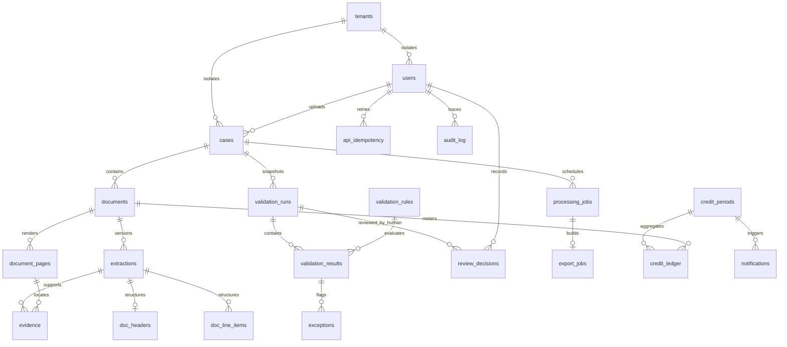

# Model data
Tujuan file ini: mendefinisikan skema relasional usulan yang cukup eksplisit untuk migrasi dan API.
Dibaca oleh / kapan dipakai: agent backend/database saat merancang transaksi, pipeline dan evidence.

## Konvensi skema
**Usulan D-009/D-010/D-011/D-013.** PostgreSQL; semua timestamp `timestamptz`, disimpan UTC. Semua tabel memiliki `id uuid PK` dan `created_at timestamptz NOT NULL`; pengecualian key disebut eksplisit. `?` = nullable; kolom lain NOT NULL. Semua FK RESTRICT, tidak CASCADE pada histori. Semua tabel kecuali tenants memiliki `tenant_id uuid FK tenants.id`; tenant isolation menggunakan composite FK `(tenant_id, foreign_id)` ke UNIQUE `(tenant_id,id)` setiap parent. Index tenant_id pada semua tabel; index FK dan waktu pada tabel event. ID dibuat server. Semua enum di bawah CHECK constrained text. Uang `numeric(24,6)`, qty `numeric(24,6)`, tidak float; format/rounding Q-007.

Mutable: `updated_at timestamptz`, `version int CHECK>0`, `deleted_at timestamptz?` untuk users/cases/documents; mutable lainnya punya updated_at/version. Immutable: extractions, evidence, doc_headers, doc_line_items, validation_rules (setiap versi), validation_runs setelah selesai, validation_results, review_decisions, credit_ledger, audit_log. Job/status boleh berubah dengan state machine. Histori superseded tetap terbaca sesuai hak.

## Tabel dan kolom
| Tabel | Kolom selain konvensi | Constraint dan index tambahan |
|---|---|---|
| tenants | name text, deployment_mode text(managed/onprem), active bool | Tidak ada API cross-tenant; bootstrap oleh operator |
| users | subject text, name text, email text, role text(STAFF/APPROVER/ADMIN/OPS), active bool, password_hash text? | UNIQUE(tenant_id,subject); unique lower(email) per tenant aktif; hash hanya adapter auth lokal |
| cases | case_number text, uploaded_by uuid FK users, processing_status text(UPLOADED/PROCESSING/EXTRACTED/VALIDATED/FAILED), validation_status text? (MATCHED/NEEDS_REVIEW/INCOMPLETE/DUPLICATE_SUSPECT), total_pages int, current_run_id uuid? FK validation_runs | UNIQUE(tenant_id,case_number); total_pages>=0; index tenant/status/created_at; index current_run_id |
| documents | case_id uuid FK cases, uploaded_by uuid FK users, doc_type text(INVOICE/PO/DELIVERY_NOTE/GOODS_RECEIPT/BAST/OTHER), object_key text, filename text, mime_type text, sha256 char(64), page_count int, state text(QUARANTINED/ACCEPTED/PROCESSING/READY/FAILED), error_code text? | page_count>=0; unique object_key per tenant; index case_id; index tenant_id,sha256 nonunique (duplicate tetap perlu disimpan sebagai kandidat) |
| document_pages | document_id uuid FK documents, page_number int, image_key text, width int, height int, ocr_text_encrypted text? | UNIQUE(tenant_id,document_id,page_number); page_number,width,height>0 |
| processing_jobs | case_id uuid FK cases, document_id uuid? FK documents, kind text(INGEST/PROCESS/REPROCESS/VALIDATE/EXPORT), status text(QUEUED/RUNNING/SUCCEEDED/FAILED), attempt int, idempotency_key text, policy_version text?, failure_code text?, available_at timestamptz, heartbeat_at timestamptz?, completed_at timestamptz? | UNIQUE(tenant_id,idempotency_key); attempt>=0; index status,available_at; DB row adalah durable outbox, Redis delivery dapat berulang |
| extractions | document_id uuid FK documents, job_id uuid FK processing_jobs, model_id text, prompt_version text, schema_version text, raw_json jsonb, quality_flags jsonb, extracted_at timestamptz | UNIQUE(tenant_id,job_id,document_id); raw_json object; tidak menyimpan hidden chain-of-thought |
| doc_headers | extraction_id uuid FK extractions, vendor_name text?, vendor_identifier text?, vendor_normalized text?, doc_number text?, normalized_number text?, doc_date date?, currency char(3)?, subtotal numeric(24,6)?, tax_amount numeric(24,6)?, total_amount numeric(24,6)?, references_json jsonb | UNIQUE(tenant_id,extraction_id); references_json object po/dn/gr/bast; index tenant,vendor_normalized,normalized_number,doc_date,total_amount untuk kandidat duplikasi |
| doc_line_items | extraction_id uuid FK extractions, line_no int, description text?, item_code text?, qty numeric(24,6)?, uom text?, unit_price numeric(24,6)?, line_total numeric(24,6)? | UNIQUE(tenant_id,extraction_id,line_no); line_no>0; tidak memaksakan angka positif sebelum Q-001 (credit note belum disepakati) |
| evidence | extraction_id uuid FK extractions, document_id uuid FK documents, page_number int, field_path text, value_json jsonb?, bbox jsonb? | FK(tenant,document_id,page_number) ke document_pages; extraction harus milik document yang sama; index extraction_id,field_path; bbox normalized [x0,y0,x1,y1] 0..1 dengan x0<=x1,y0<=y1; missing field boleh value null dan absence evidence eksplisit |
| validation_rules | code text, rule_version int, description text, params jsonb, severity text(INFO/WARN/ERROR), active bool, approved_by uuid? FK users, change_reason text | UNIQUE(tenant_id,code,rule_version); rule_version>0; tidak ada endpoint membuat logic; aktivasi hanya konfigurasi yang disetujui |
| validation_runs | case_id uuid FK cases, job_id uuid FK processing_jobs, rules_snapshot jsonb, extraction_ids jsonb, status text(RUNNING/COMPLETED/FAILED), overall_status text?, started_at timestamptz, finished_at timestamptz? | job_id unique per tenant; overall_status enum sama dengan cases; completed wajib finished_at dan status validasi; index case_id,started_at |
| validation_results | run_id uuid FK validation_runs, rule_id uuid FK validation_rules, outcome text(PASS/FAIL/SKIPPED/INCOMPLETE), reason_code text, reasoning text, computed_values jsonb, evidence_ids jsonb | UNIQUE(tenant_id,run_id,rule_id); evidence_ids array UUID, server memverifikasi seluruh referensi dalam tenant/run; sumber tidak ada pakai reason_code MISSING_SOURCE dan evidence yang tersedia, bukan evidence palsu |
| exceptions | case_id uuid FK cases, run_id uuid FK validation_runs, result_id uuid FK validation_results, type text(MISMATCH/DUPLICATE_SUSPECT/MISSING_INFO), severity text(INFO/WARN/ERROR), state text(OPEN/IN_REVIEW/RESOLVED), summary text, assigned_to uuid? FK users | index tenant,state,severity,created_at; resolve adalah penanganan exception, bukan approval invoice |
| review_decisions | case_id uuid FK cases, run_id uuid FK validation_runs, decided_by uuid FK users, decision text(ACCEPTED/REJECTED/NEEDS_CLARIFICATION), note text, supersedes_id uuid? FK review_decisions, decided_at timestamptz | append-only; FK run harus case sama; only human APPROVER aktif, tidak system token; index case_id,decided_at; unique supersedes_id nonnull per tenant |
| export_jobs | requested_by uuid FK users, filter_snapshot jsonb, run_ids jsonb, format text(CSV/XLSX), status text(QUEUED/RUNNING/READY/FAILED/EXPIRED), object_key text?, expires_at timestamptz?, job_id uuid FK processing_jobs | format kandidat Q-003; index requested_by,created_at; unique job_id |
| credit_periods | period_key text, starts_at timestamptz, ends_at timestamptz, quota int, policy_version text, state text(OPEN/CLOSED), closed_at timestamptz? | UNIQUE(tenant_id,period_key); quota=50000; starts_at<ends_at; periode tidak overlap per tenant via exclusion/range constraint |
| credit_ledger | period_id uuid FK credit_periods, document_id uuid FK documents, job_id uuid? FK processing_jobs, billing_event_key text, entry_type text(CHARGE/ADJUSTMENT), pages int, credits int, adjusts_id uuid? FK credit_ledger, actor_id uuid? FK users, reason text?, recorded_at timestamptz | UNIQUE(tenant_id,billing_event_key); CHARGE pages>0 dan credits=pages; ADJUSTMENT credits!=0, pages=credits signed, adjusts_id/actor/reason wajib; index period_id,recorded_at; tidak ada unique(document_id) karena kebijakan Q-011 belum final |
| notifications | period_id uuid FK credit_periods, recipient_id uuid FK users, type text(NEAR_QUOTA/QUOTA_REACHED/QUOTA_EXCEEDED), read_at timestamptz? | UNIQUE(tenant_id,period_id,recipient_id,type); hanya in-app; tidak otomatis kirim email |
| api_idempotency | actor_id uuid FK users, route text, key text, request_hash char(64), response_ref jsonb, status_code int, expires_at timestamptz | UNIQUE(tenant_id,actor_id,route,key); response hanya ID/minimal, tidak blob; ttl Q-005 |
| audit_log | actor_id uuid? FK users, actor_type text(HUMAN/SYSTEM), action text, entity_type text, entity_id uuid?, request_id uuid, metadata jsonb, occurred_at timestamptz, previous_hash text?, entry_hash text | index tenant,occurred_at/action/entity_id; allowlisted metadata [AUDIT](AUDIT.md), append-only |

Tidak ada vendors master: identitas vendor adalah data hasil ekstraksi, bukan fitur manajemen vendor. Nullable field bukan izin menebak nilai. Evidence menyimpan semua field terisi termasuk tiap referensi dan field line item, bukan hanya total/nomor.

## ERD

Tenant linkage convention applies to every table even when omitted from ERD to keep readable.

## Aturan transaksi dan proses pemakai
| Proses / endpoint | Tabel yang dipakai |
|---|---|
| Bootstrap/auth/admin | tenants, users; api_idempotency, audit_log untuk mutasi |
| Upload/case/job recovery | cases, documents, document_pages, processing_jobs |
| AI extraction dan viewer | extractions, doc_headers, doc_line_items, evidence |
| Validasi dan review | validation_rules, validation_runs, validation_results, exceptions, review_decisions |
| Export API/worker | export_jobs, processing_jobs dan snapshot hasil |
| Credit endpoints/month-close | credit_periods, credit_ledger, notifications |
| Semua mutasi/retry/audit API | api_idempotency, audit_log |

Upload diterima secara atomik: metadata + job durable + audit. Objek staging harus selesai diverifikasi sebelum document ACCEPTED; orphan staging dibersihkan terkontrol. Worker menggunakan claim/lease job, boleh at-least-once; hasil commit dengan unique key. Meter event dan notification dibuat dalam transaksi dengan lock periode tenant; retry event yang sama tidak menambah credit. Kebijakan event Q-011 bukan ditentukan hash file: file sama di case baru tetap kandidat duplikasi, keputusan charge menunggu kebijakan.

Duplikasi: kandidat dari sha256 dan kombinasi vendor_normalized/normalized_number/doc_date/total_amount; jangan auto-merge atau menolak upload. Normalisasi dan search horizon Q-017; total/currency dibandingkan hanya bila sebanding. Tanpa identitas vendor cukup, tandai ketidakpastian. Review wajib expected run/version dan Approver user context; application service worker tidak punya privilege INSERT review_decisions, trigger juga menolak actor bukan manusia aktif. Koreksi extraction/review membuat versi baru, tidak overwrite histori.

## Retensi dan migrasi
Default usulan: soft delete case/document/user, tidak menghapus ledger/audit/review. Tidak mengaktifkan purge produksi sebelum Q-005; pembatasan akses dan monitoring kapasitas tetap berjalan. Deletion API produksi ditunda Q-005. Object lifecycle dan backup tunduk kebijakan yang sama. Append-only ditegakkan GRANT/REVOKE dan trigger, bukan hanya konvensi kode. Integrity hash audit diverifikasi di luar DB sesuai [AUDIT](AUDIT.md).

Alembic migrasi versioned, forward expand/backfill/contract, backup sebelum perubahan; coba upgrade dari release sebelumnya dan restore di staging. Jangan downgrade destruktif histori; rollback aplikasi gunakan schema kompatibel atau restore teruji. Schema changes wajib memperbarui [API_CONTRACT](API_CONTRACT.md), [TESTING](TESTING.md), [DECISIONS](DECISIONS.md).
