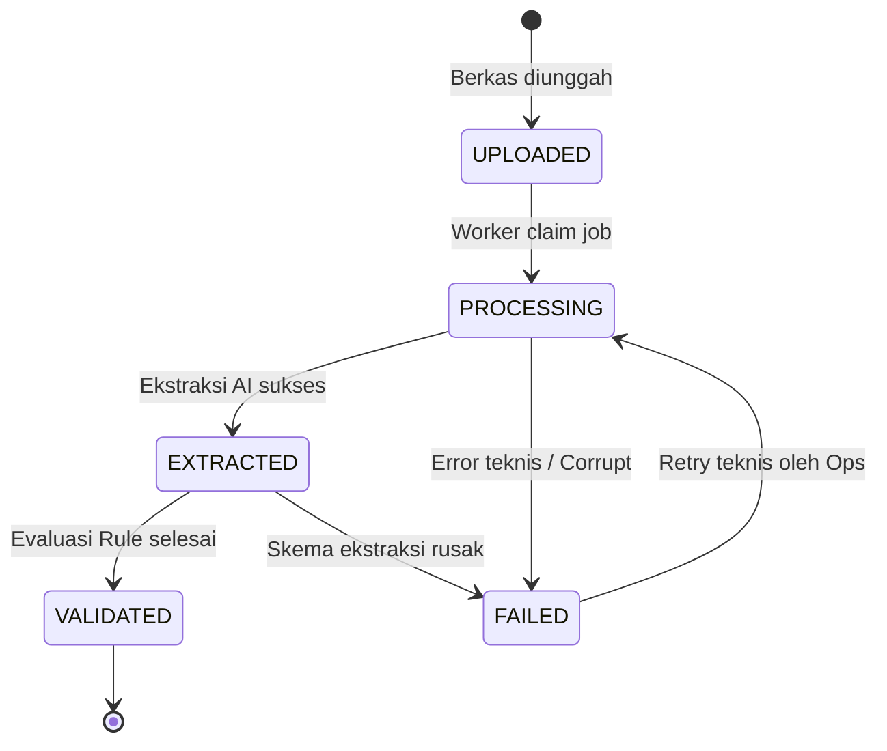
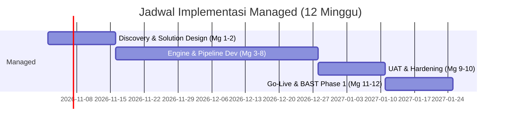

# Product Requirements Document (PRD)
Tujuan file ini: menetapkan ruang lingkup produk, kebutuhan pengguna terstruktur, aturan status state machine, dan batasan operasional.
Dibaca oleh / kapan dipakai: tim produk, lead developer, solusi arsitek, dan komite pengarah PT SIS saat fase Discovery, UAT, dan Go-Live.

## Masalah dan tujuan
PT SIS menerima ribuan invoice bersama dokumen pendukung (PO, Surat Jalan/Delivery Note, Goods Receipt, BAST) dari ratusan mitra kerja dan vendor operasional pertambangan. Sebagai gambaran ilustrasi proposal: sekitar 5.000 invoice/bulan dengan rata-rata 100 halaman pendukung per bundel (~500.000 halaman/bulan). Proses verifikasi silang manual saat ini membutuhkan 12–13 staf akuntansi (20 hari kerja/bulan, 8 jam/hari) dengan risiko kelelahan kognitif dan keterlambatan verifikasi. Beban ilustrasi ini bukan komitmen volume wajib atau jaminan kuota, namun menjadi tolak ukur perancangan kapasitas platform.

### Tujuan Utama:
1. **Reduce Invoice Processing Cost & Effort:** Menurunkan biaya dan waktu peninjauan invoice melalui otomasi ekstraksi data dan validasi silang otomatis berbasis aturan.
2. **Increase Scalability and Processing Speed:** Meningkatkan kapasitas pemrosesan tanpa perlu menambah jumlah staf operasional akuntansi secara proporsional.
3. **Transparent Reasoning with Strict Human Control:** Menyediakan platform cerdas yang mengekstraksi data secara format-agnostic (tanpa template per vendor), memvalidasi kesesuaian lintas-dokumen, menampilkan bukti visual (evidence), serta menjaga kendali keputusan 100% pada manusia. Sistem DILARANG membuat keputusan persetujuan atau pembayaran otomatis.

---

## Persona dan akses usulan

| Peran Pengguna | Tanggung Jawab Utama | Batasan Akses & Otoritas |
|---|---|---|
| **Finance Staff (STAFF)** | Mengunggah bundel berkas faktur, memantau antrean pemrosesan, meninjau selisih pada antrean exception, menelusuri evidence, dan mengekspor snapshot data. | DILARANG mencatat keputusan akhir persetujuan/penolakan faktur dan dilarang mengubah konfigurasi sistem. |
| **Approver (APPROVER)** | Meninjau hasil pemeriksaan sistem, memeriksa dokumen sumber asli, dan mencatat keputusan manusia (`ACCEPTED`, `REJECTED`, `NEEDS_CLARIFICATION`) bersama catatan resmi. | DILARANG mengeksekusi transfer/pembayaran dana langsung dan dilarang mengubah parameter rule. |
| **Admin (ADMIN)** | Mengelola akun pengguna, mengatur parameter toleransi aturan validasi eksisting, memantau pemakaian kuota kredit Managed, dan memeriksa log audit. | BUKAN Approver faktur secara otomatis; dilarang mencatat keputusan review atas nama Approver. |
| **INaAI Ops (OPS)** | Memantau kesehatan teknis server, merestart antrean job worker yang gagal, dan memelihara infrastruktur. | DILARANG membaca isi berkas dokumen, nama vendor, atau nilai finansial secara default; dilarang menyetujui faktur. |

---

## Fitur dan user stories

| ID Fitur | ID Story | User Story (Format Baku) | Ringkasan Kebutuhan & Acceptance | Kriteria Terkait |
|---|---|---|---|:---:|
| **F-01** | `US-UPLOAD-01` | **Sebagai** Finance Staff, **saya ingin** mengunggah berkas PDF/gambar invoice beserta dokumen pendukung (PO, DN, GR, BAST) ke dalam Case baru, **agar** berkas dapat diproses dan dihitung halamannya secara akurat. | **Given** berkas PDF valid berukuran <= 50 MB, **When** diunggah ke endpoint upload, **Then** sistem membuat rekaman dokumen, menghitung total halaman, dan memulai job ingestion. | [A-UPLOAD-01, A-PAGECOUNT-01](ACCEPTANCE.md#upload-dan-pemrosesan) |
| **F-01** | `US-MONITOR-01` | **Sebagai** Finance Staff, **saya ingin** memantau tahapan pemrosesan berkas secara real-time, **agar** saya mengetahui kapan dokumen selesai diproses atau jika terjadi kegagalan teknis. | **Given** job pemrosesan sedang berjalan, **When** staf membuka dashboard, **Then** status ditampilkan (`UPLOADED -> PROCESSING -> EXTRACTED -> VALIDATED`). | [A-MONITOR-01](ACCEPTANCE.md#upload-dan-pemrosesan) |
| **F-02** | `US-EXTRACT-01` | **Sebagai** Finance Staff, **saya ingin** sistem mengekstrak field kunci transaksi (vendor, nomor, tanggal, item, qty, harga, pajak, total) beserta lokasi buktinya, **agar** saya tidak perlu mengetik ulang data manual. | **Given** dokumen lolos ekstraksi AI, **When** data tersimpan di database, **Then** setiap nilai terisi memiliki rujukan halaman dan bounding box yang valid. | [A-EXTRACT-01, A-ACCURACY-01, A-UNREADABLE-01](ACCEPTANCE.md#ekstraksi) |
| **F-03** | `US-VALIDATE-01` | **Sebagai** Finance Staff, **saya ingin** sistem menjalankan aturan validasi silang (VR-001 s.d. VR-009) antara invoice terhadap PO, DN, GR, dan BAST, **agar** setiap selisih nilai, kuantitas, atau potensi duplikasi terdeteksi otomatis. | **Given** data ekstraksi lengkap, **When** rule engine dieksekusi secara deterministik, **Then** hasil per aturan (`PASS/FAIL/INCOMPLETE`) dan status agregasi dihasilkan. | [A-RULES-01, A-EVIDENCE-01, A-PRECEDENCE-01, A-DUPLICATE-01](ACCEPTANCE.md#validasi) |
| **F-04** | `US-REVIEW-01` | **Sebagai** Approver PT SIS, **saya ingin** meninjau rincian selisih dan bukti dokumen asli lalu mencatat keputusan resmi saya, **agar** proses tata kelola persetujuan faktur tercatat akuntabel. | **Given** case berstatus `NEEDS_REVIEW` atau `MATCHED`, **When** Approver mengisi form keputusan dan note, **Then** catatan keputusan tersimpan append-only dan terikat pada run aktif. | [A-HUMAN-01, A-APPROVER-01, A-NEUTRAL-01, A-QUEUE-01](ACCEPTANCE.md#human-control) |
| **F-05** | `US-EXPORT-01` | **Sebagai** Finance Staff, **saya ingin** mengekspor ringkasan data hasil validasi ke format CSV atau XLSX, **agar** dapat dianalisis lebih lanjut di spreadsheet internal. | **Given** kumpulan case yang diotorisasi, **When** staf meminta ekspor, **Then** sistem membuat berkas terstruktur yang bebas dari formula injection. | [A-EXPORT-01](ACCEPTANCE.md#dashboard-dan-ekspor) |
| **F-06** | `US-CREDIT-01` | **Sebagai** Admin PT SIS, **saya ingin** memantau pemakaian kuota 50.000 kredit bulanan dan estimasi biaya overage pada skema Managed, **agar** anggaran operasional terpantau transparan. | **Given** skema Managed aktif, **When** dokumen diproses, **Then** kredit terpotong 1 kredit/halaman dan notifikasi terkirim jika mendekati batas kuota. | [A-CREDITMETER-01, A-CREDITQUOTA-01, A-CREDITNOTIF-01, A-ONPREM-01](ACCEPTANCE.md#credit) |
| **F-07** | `US-ADMIN-01` | **Sebagai** Admin PT SIS, **saya ingin** mengelola akun pengguna dan menyesuaikan parameter toleransi aturan validasi eksisting, **agar** sistem fleksibel terhadap kebijakan internal. | **Given** otorisasi role Admin, **When** parameter diubah melalui API/UI, **Then** versi aturan baru dibuat dengan alasan dan tercatat pada log audit. | [A-ADMIN-01](ACCEPTANCE.md#keamanan-dan-administrasi) |
| **F-08** | `US-OPS-01` | **Sebagai** INaAI Ops, **saya ingin** memantau kesehatan sistem dan melakukan retry teknis pada job yang gagal, **agar** ketersediaan platform terjaga tanpa melihat data finansial rahasia. | **Given** job mengalami kegagalan teknis, **When** Ops memicu retry melalui API sanitasi, **Then** job diproses ulang dengan kunci idempotensi yang aman. | [A-PERF-01, A-RECOVERY-01, A-RESTORE-01, A-SECURITY-01](ACCEPTANCE.md#kinerja-dan-keandalan) |
| **F-09** | `US-HANDOVER-01` | **Sebagai** Project Sponsor PT SIS, **saya ingin** menerima dokumentasi lengkap, pelatihan pengguna, dan hasil UAT yang tervalidasi, **agar** serah terima BAST Phase 1 dapat disahkan. | **Given** seluruh pengujian UAT lulus, **When** pelatihan selesai diselenggarakan, **Then** berkas handover diserahkan dan BAST Phase 1 ditandatangani. | [A-HANDOVERDOC-01, A-TRAINING-01, A-SIGNBAST-01](ACCEPTANCE.md#serah-terima) |

---

## Status dan aturan perilaku

Sistem membedakan tiga dimensi status independen untuk menjamin pemisahan status teknis, hasil analisis data, dan wewenang manusia:

### 1. State Machine: Kasus (`cases.processing_status`)
| Transisi Status | Pemicu (Trigger) | Aktor | Guard / Syarat | Efek Samping | Event Audit |
|---|---|:---:|---|---|---|
| `[*] -> UPLOADED` | Endpoint `POST /cases` | STAFF/APPROVER | Payload valid | Inisialisasi case record | `CASE_CREATED` |
| `UPLOADED -> PROCESSING` | Worker mengambil outbox job | SYSTEM | Job berstatus QUEUED | Lock record, set attempt | `JOB_STARTED` |
| `PROCESSING -> EXTRACTED` | Worker selesai ekstraksi seluruh doc | SYSTEM | JSON Schema valid | Simpan entri extractions | `EXTRACTION_COMPLETED` |
| `EXTRACTED -> VALIDATED` | Rule Engine selesai evaluasi | SYSTEM | Hasil rule tersimpan | Hitung agregasi status | `VALIDATION_COMPLETED` |
| `ANY -> FAILED` | Kegagalan teknis / unhandled crash | SYSTEM | Max retry habis | Catat failure_code | `JOB_FAILED` |

### 2. State Machine: Dokumen (`documents.state`)
- `QUARANTINED`: Berkas baru diunggah, menunggu inspeksi magic bytes, malware scanning, dan pemeriksaan proteksi sandi PDF.
- `ACCEPTED`: Berkas lolos uji keamanan; jumlah halaman berhasil dihitung (memicu pencatatan kredit pada Managed).
- `PROCESSING`: Berkas sedang dirender menjadi gambar dan diekstraksi oleh worker AI.
- `READY`: Ekstraksi berkas selesai dan data terstruktur tersimpan di database.
- `FAILED`: Berkas rusak (corrupt), terenkripsi, melebihi batas halaman, atau gagal diproses.

### 3. State Machine: Pengecualian (`exceptions.state`)
- `OPEN`: Selisih baru terdeteksi oleh rule engine; masuk dalam antrean peninjauan.
- `IN_REVIEW`: Staf akuntansi sedang melakukan investigasi atau meminta konfirmasi ke vendor/lapangan.
- `RESOLVED`: Pengecualian telah ditinjau dan diberi catatan penjelasan. *Perhatian:* Penutupan exception TIDAK mengubah status validasi case dan BUKAN persetujuan pembayaran.

### 4. State Machine: Periode Kredit (`credit_periods.state`)
- `OPEN`: Periode bulan berjalan aktif menerima pemotongan kredit transaksi.
- `CLOSED`: Periode telah ditutup pada akhir bulan; dilakukan rekonsiliasi total pemakaian dan pembentukan periode baru.

### 5. State Machine: Berkas Ekspor (`export_jobs.status`)
- `QUEUED -> RUNNING -> READY -> EXPIRED`: Berkas siap diunduh oleh pemohon, dan otomatis kedaluwarsa setelah melewati TTL 24 jam.

---

## In scope
1. **Design Business Process & Validation Framework:** Pemetaan alur verifikasi faktur dan penyusunan kriteria toleransi bersama PT SIS.
2. **Multi-Document Ingestion & Capture:** Penerimaan berkas digital (PDF, gambar) dokumen faktur, PO, Surat Jalan, GR, dan BAST.
3. **AI-Based Context-Aware Extraction:** Ekstraksi field kunci dan tabel baris item tanpa bergantung pada template visual vendor.
4. **Policy-Driven Validation Engine:** Evaluasi deterministik lintas-dokumen berbasis kode (VR-001 s.d. VR-009).
5. **Finance Operations Dashboard:** Antarmuka web modern untuk pemantauan, antrean pengecualian, viewer split-screen dengan sorotan bukti visual (evidence), serta form catatan keputusan manusia bagi Approver.
6. **Ekspor Data Terstruktur:** Ekspor hasil validasi dalam format CSV dan XLSX.
7. **Credit Metering (Managed):** Pencatatan konsumsi kredit (1 kredit = 1 halaman) dengan pelacakan overage dan notifikasi kuota.
8. **Deployment & Handover:** Instalasi pada cloud INaAI (Managed) atau infrastruktur PT SIS (On-Premise), pelatihan pengguna, dokumentasi, dan serah terima BAST Phase 1.

---

## Out of scope (Batas Mutlak)
1. **Keputusan Pembayaran Otomatis:** Sistem DILARANG membuat keputusan akhir persetujuan/penolakan pembayaran; kewenangan 100% pada Approver manusia PT SIS.
2. **Perbaikan & Digitalisasi Dokumen Fisik:** Tidak mencakup pemindaian fisik kertas (scanning service) atau perbaikan manual dokumen sumber yang rusak.
3. **Koneksi Langsung ke ERP / SAP / Sistem Pembayaran:** Tidak ada integrasi langsung via API/database ke SAP atau core financial system PT SIS; input murni melalui pengunggahan berkas.
4. **Alur Procure-to-Pay (P2P) End-to-End:** Tidak mencakup pembuatan PO baru, approval penerimaan barang di gudang, atau manajemen vendor supplier.
5. **Penilaian Hukum, Pajak, dan Deteksi Fraud Investigatif:** Sistem bukan alat audit forensik, opini hukum perpajakan, atau penilai kepatuhan regulasi. Selisih pajak hanya perbandingan matematis angka tercetak.
6. **Penyerahan Source Code:** Hak cipta dan source code aplikasi tidak diserahkan pada kedua skema deployment (Managed maupun On-Premise).
7. **Pengadaan Perangkat Keras On-Premise:** Server, storage, jaringan, dan lisensi OS pada skema On-Premise adalah tanggung jawab pengadaan PT SIS.
8. **Pengembangan Fitur Baru di Luar Scope Saat Maintenance:** Layanan pemeliharaan Managed Phase 2 hanya mencakup perbaikan bug dan monitoring, fitur baru wajib melalui Change Request (CR).

---

## Model komersial

| Parameter Komersial | Managed Subscription Service | On-Premise Licensed Deployment |
|---|---|---|
| **Infrastruktur Hosting** | Cloud disediakan dan dikelola penuh oleh INaAI | Server & hardware disediakan/dikelola mandiri oleh PT SIS |
| **Project Fee (Implementasi)** | **IDR 500.000.000** | **IDR 1.500.000.000** |
| **Termin Pembayaran Project Fee** | 50% saat kick-off proyek, 50% setelah penandatanganan BAST Phase 1 | 50% saat kick-off proyek, 50% setelah penandatanganan BAST Phase 1 |
| **Biaya Berulang (Recurring)** | **IDR 50.000.000 / bulan** (termasuk hosting, AI credit, maintenance) | **IDR 500.000.000 / tahun** (lisensi tahunan & maintenance support) |
| **Kuota Pemrosesan Halaman** | **50.000 kredit/bulan** (1 kredit = 1 halaman dokumen) | Sesuai kapasitas server PT SIS; tanpa batasan kredit |
| **Biaya Pemakaian Tambahan** | **IDR 500 / kredit** untuk pemakaian di atas 50.000 kredit/bulan | Tidak berlaku (tanpa biaya pemakaian tambahan) |
| **Aturan Kuota Kredit** | Kuota bulanan tetap ditagih penuh meski tidak terpakai; sisa kredit hangus (tidak rollover) | Tidak berlaku |
| **Dukungan Maintenance** | Layanan dukungan operasional, pemantauan proaktif, dan bug fixing | Alokasi dukungan maintenance terjadwal 1 hari kerja per minggu |
| **Komitmen Kontrak Minimum** | Minimal **12 bulan langganan** terhitung sejak serah terima BAST Phase 1 | Lisensi berlaku 12 bulan sejak sistem aktif terkonfigurasi |
| **Total Estimasi Tahun Pertama** | **IDR 1.100.000.000** (Project fee IDR 500 jt + Langganan 12 bln IDR 600 jt; belum termasuk overage pemakaian) | **IDR 2.000.000.000** (Project fee IDR 1,5 M + Lisensi tahunan IDR 500 jt) |

*Catatan Pajak & Biaya Riil:* Seluruh nilai komersial di atas belum termasuk PPN 11% dan Out-of-Pocket Expenses (biaya akomodasi/transportasi jika penugasan ke site tambang di luar Jakarta atas persetujuan PT SIS).

---

## Timeline implementasi

### Rincian Tahapan Managed (12 Minggu Total):
1. **Minggu 1–2 (Discovery & Solution Design):** Pemetaan proses bisnis faktur, penyepakatan parameter toleransi (Q-001 s.d. Q-017), penyusunan rancangan arsitektur detail, dan penyiapan dataset sintetis.
2. **Minggu 3–8 (Engine & Dashboard Development):** Pembangunan pipeline ingestion, modul ekstraksi AI (P-001 s.d. P-004), rule engine validasi deterministik, metering kredit, dan Finance Operations Dashboard.
3. **Minggu 9–10 (User Acceptance Testing - UAT):** Pelaksanaan pengujian UAT bersama tim Finance PT SIS, penyesuaian minor dalam lingkup, serta pengujian ketahanan beban.
4. **Minggu 11–12 (Operational Adoption, Training, & Go-Live):** Pelatihan pengguna akhir, penyerahan panduan operasional, deployment produksi cloud INaAI, dan penandatanganan BAST Phase 1.

### Jadwal Skema Alternatif On-Premise (16 Minggu + Pengadaan 2-3 Bulan):
- **Bulan 1–3 (Tersendiri):** Pengadaan perangkat keras server & GPU oleh PT SIS.
- **Minggu 1–4:** Infrastructure Understanding & Readiness Planning.
- **Minggu 5–6:** Discovery & Solution Design.
- **Minggu 7–10:** Engine & Dashboard Development (Porting arsitektur portabel).
- **Minggu 11–12:** Infrastructure Preparation & System Initialization.
- **Minggu 13–14:** UAT pada lingkungan lokal PT SIS.
- **Minggu 15–16:** Pelatihan, Go-Live On-Premise, dan Serah Terima BAST.

---

## Asumsi dan metrik sukses

### Kebutuhan Non-Fungsional (NFR Kuantitatif):
1. **Throughput Pemrosesan:** Mampu memproses throughput rata-rata minimal **700 halaman per jam** (ekuivalen ~500.000 halaman/bulan pada jam kerja) dengan kemampuan burst hingga 1.500 halaman/jam.
2. **Kecepatan Inferensi (Latency):** Rata-rata waktu pemrosesan dokumen (ingestion s.d. validasi selesai) **p50 <= 15 detik/halaman** dan **p95 <= 30 detik/halaman** (asumsi antrean normal).
3. **Ketersediaan Layanan (Availability):** Tingkat ketersediaan aplikasi minimal **99.5% uptime** pada jam kerja operasional (08:00 - 17:00 WIB, Senin-Jumat).
4. **Target Akurasi Ekstraksi AI:** Akurasi pembacaan field kunci (nomor faktur, tanggal, total nilai, kuantitas) minimal **>= 85%** pada held-out dataset sintetis dan sampel UAT.
5. **Recall Deteksi Kesalahan (Fault Recall):** Tingkat keberhasilan mendeteksi selisih faktur vs PO/GR minimal **>= 95%** pada dataset pengujian kesalahan (*fault test cases*).
6. **Keamanan & Ketahanan Data:** RPO (Recovery Point Objective) database **<= 1 jam** dan RTO (Recovery Time Objective) **<= 4 jam**. Seluruh data dokumen dienkripsi saat transit (TLS 1.3) dan saat diam (AES-256).
