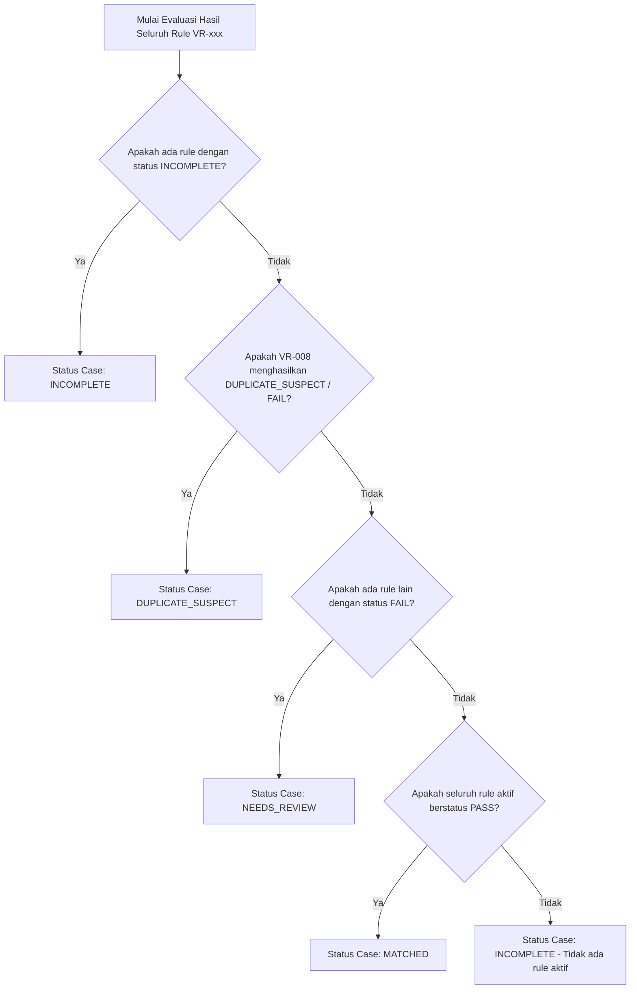

# Katalog Aturan Validasi (Validation Rules)
Tujuan file ini: mendefinisikan seluruh aturan validasi deterministik lintas-dokumen, formula, normalisasi, dan template reasoning.
Dibaca oleh / kapan dipakai: tim backend/rules engine, AI pipeline, QA, serta tim Bisnis/Finance PT SIS dalam evaluasi kesesuaian faktur.

## Prinsip dan kebijakan validasi
1. **Evaluasi Deterministik Berbasis Kode:** Seluruh perbandingan angka, tanggal, toleransi, dan formula dihitung secara matematis menggunakan tipe data `Decimal` pada kode aplikasi (service `packages/rules`), BUKAN dihitung oleh LLM. LLM hanya digunakan untuk ekstraksi data berstruktur, usulan kandidat pencocokan semantik baris, dan penyusunan narasi penjelasan terbatas berdasar fakta terverifikasi.
2. **Keterlacakan Evidence 100%:** Setiap hasil validasi (`PASS`, `FAIL`, `INCOMPLETE`) WAJIB merujuk pada evidence konkret yang mencakup `document_id`, `page_number`, `field_path`, dan nilai aktual. Jika data sumber tidak ditemukan, sistem WAJIB menandainya secara eksplisit sebagai data tidak tersedia (`MISSING_SOURCE`), DILARANG mengarang referensi lokasi palsu.
3. **Format-Agnostic & Tanpa Template Vendor:** Aturan validasi berlaku umum untuk seluruh dokumen invoice, PO, DN, GR, dan BAST terlepas dari variasi tata letak visual vendor.
4. **Bukan Penentu Keputusan Pembayaran:** Hasil validasi sistem adalah ringkasan teknis pencocokan data (`MATCHED`, `NEEDS_REVIEW`, `INCOMPLETE`, `DUPLICATE_SUSPECT`). Sistem DILARANG melakukan persetujuan (approval) atau penolakan (rejection) faktur secara otomatis. Keputusan akhir sepenuhnya wewenang manusia (role `APPROVER` PT SIS).
5. **Netralitas Analisis:** Sistem hanya mendeteksi selisih matematis dan ketidaksesuaian referensi. DILARANG membuat kesimpulan atau menggunakan terminologi fraud, penipuan, pelanggaran hukum, atau kepatuhan pajak.

---

## Aturan agregasi status validasi
Satu kasus (`case`) dapat menjalankan beberapa aturan validasi `VR-xxx`. Hasil akhir tingkat case (`cases.validation_status`) ditentukan melalui aturan agregasi preseden (precedence rule) berurutan dari prioritas tertinggi ke terendah:



### Tabel Preseden Status Agregasi:
| Preseden | Kondisi Hasil Rule | `cases.validation_status` | Keterangan & Tindakan |
|:---:|---|---|---|
| **1 (Tertinggi)** | Minimal 1 rule aktif menghasilkan `INCOMPLETE` (data sumber tidak terbaca atau dokumen wajib belum diunggah) | `INCOMPLETE` | Finance Staff perlu mengunggah dokumen pelengkap atau dokumen dengan pemindaian lebih jelas. |
| **2** | Rule `VR-008` (Deteksi Duplikasi) menghasilkan `FAIL` | `DUPLICATE_SUSPECT` | Indikasi kemiripan/identitas ganda dengan invoice lain. Perlu peninjauan silang dua dokumen. |
| **3** | Minimal 1 rule aktif menghasilkan `FAIL` (selisih nilai/qty melebihi batas toleransi) | `NEEDS_REVIEW` | Terdapat perbedaan data faktur vs dokumen pemesanan/penerimaan yang membutuhkan investigasi Finance. |
| **4 (Terendah)** | Seluruh rule aktif yang berlaku untuk tipe transaksi tersebut menghasilkan `PASS` | `MATCHED` | Data dokumen saling cocok sesuai parameter yang ditetapkan. Tetap membutuhkan review akhir Approver. |

*Catatan Khusus:* Jika dalam sebuah tenant tidak ada rule aktif sama sekali, status case adalah `INCOMPLETE` dengan kode alasan `NO_ACTIVE_RULES`, DILARANG menghasilkan status `MATCHED`.

---

## Parameter konfigurasi terpusat
Seluruh parameter toleransi dan ambang batas disimpan dalam tabel `validation_rules.params` dalam format JSON bertipe. Admin PT SIS dapat menyesuaikan nilai parameter melalui API/UI Admin ber-versi tanpa mengubah kode program.

| Kode Parameter | Tipe Data | Nilai Usulan Default | Deskripsi & Batasan Nilai | Referensi Terkait |
|---|:---:|:---:|---|:---:|
| `total_amount_tolerance` | Numeric String | `"0.00"` | Toleransi selisih total invoice vs PO (dalam mata uang transaksi). Nilai `>= 0.00`. | `Q-001` |
| `unit_price_tolerance` | Numeric String | `"0.00"` | Toleransi selisih harga satuan invoice vs PO. Nilai `>= 0.00`. | `Q-001` |
| `qty_tolerance_percent` | Numeric String | `"0.00"` | Persentase toleransi kelebihan kuantitas invoice terhadap GR/DN (0.00 = 0%). | `Q-001` |
| `tax_amount_tolerance` | Numeric String | `"1.00"` | Toleransi selisih pembulatan nilai pajak internal invoice (IDR). | `Q-001` |
| `duplicate_similarity_threshold` | Numeric String | `"0.95"` | Ambang kemiripan string nama vendor (0.00 s.d. 1.00). | `Q-017` |
| `duplicate_date_window_days` | Integer | `90` | Rentang pencarian kandidat duplikasi tanggal faktur (hari). | `Q-017` |
| `ocr_min_confidence_score` | Numeric String | `"0.70"` | Skor keyakinan minimum OCR agar field dianggap terbaca valid. | `Q-009` |

---

## Aturan normalisasi data
Sebelum aturan validasi dieksekusi, data hasil ekstraksi wajib melewati normalisasi deterministik berikut:
1. **Normalisasi Angka (Numeric):**
   - Menghapus pemisah ribuan (titik `.` atau koma `,` sesuai locale).
   - Mengubah tanda minus dalam kurung `(100.000)` menjadi `-100000.00`.
   - Mengonversi string ke tipe `Decimal` dengan presisi 24 digit dan skala 6 digit (`NUMERIC(24,6)`).
2. **Normalisasi Tanggal (Date):**
   - Mengubah seluruh format tanggal lokal (misal: "25 Oktober 2026", "25/10/2026", "2026-10-25") menjadi format standar ISO-8601: `YYYY-MM-DD`.
   - Tanggal ambigu (misal "04/05/2026") yang tidak dapat dipastikan urutan bulan/harinya WAJIB diisi `null` dan ditandai flag `AMBIGUOUS_DATE`.
3. **Normalisasi Teks & Identifier:**
   - Menghilangkan spasi ganda, spasi di awal/akhir string (trim).
   - Menghapus tanda baca pemisah nomor faktur/PO (karakter `-`, `/`, `.`, spasi) untuk keperluan pencocokan indeks duplikasi (`normalized_number`). Contoh: `INV/2026/X-001` -> `INV2026X001`.
   - Nama vendor dikonversi menjadi huruf kapital, menghapus bentuk badan hukum (`PT`, `CV`, `TBK`, `LTD`) untuk keperluan perbandingan kemiripan (`vendor_normalized`).
4. **Normalisasi Mata Uang (Currency):**
   - Menstandarkan simbol ke kode ISO-4217 3 huruf: `Rp`, `IDR`, `Rp.` -> `IDR`; `$`, `USD` -> `USD`.

---

## Katalog aturan validasi

### VR-001: Total Invoice vs Total PO (VR_TOTAL_COMPARE)
- **Tujuan Bisnis:** Memastikan total tagihan pada faktur tidak melebihi nilai total komitmen pemesanan pada Purchase Order (PO).
- **Dokumen yang Dibandingkan:** `INVOICE` vs `PO`.
- **Field & Sumber:**
  - Invoice: `doc_headers.total_amount`, `doc_headers.currency`
  - PO: `doc_headers.total_amount`, `doc_headers.currency`
- **Pseudocode Definisi Formal:**
  ```python
  if invoice.total_amount is None or po.total_amount is None:
      return Outcome.INCOMPLETE, "MISSING_TOTAL_FIELD"
  if invoice.currency != po.currency:
      return Outcome.FAIL, "CURRENCY_MISMATCH"
  diff = invoice.total_amount - po.total_amount
  tolerance = Decimal(params["total_amount_tolerance"])
  if diff > tolerance:
      return Outcome.FAIL, "INVOICE_TOTAL_EXCEEDS_PO"
  else:
      return Outcome.PASS, "TOTAL_MATCHED"
  ```
- **Parameter Konfigurasi:** `total_amount_tolerance` (Default: `"0.00"`, `Q-001`).
- **Outcome & Severity:**
  - `PASS`: Nilai selisih `<= tolerance` (Severity: `INFO`).
  - `FAIL`: Nilai invoice melebihi PO `> tolerance` (Severity: `ERROR`).
  - `INCOMPLETE`: Salah satu field total tidak terbaca / null (Severity: `WARN`).
- **Template Reasoning (Bahasa Indonesia):**
  - *PASS:* "Nilai total invoice ({inv_total} {curr}) sesuai dengan total PO ({po_total} {curr}) dengan selisih {diff} {curr} dalam batas toleransi {tol} {curr}."
  - *FAIL:* "Nilai total invoice ({inv_total} {curr}) melebihi nilai total PO ({po_total} {curr}) sebesar {diff} {curr} (batas toleransi: {tol} {curr}). Periksa dokumen sumber invoice hal. {inv_page} dan PO hal. {po_page}."
  - *INCOMPLETE:* "Data total nilai transaksi tidak dapat terbaca lengkap pada salah satu dokumen sumber. Periksa invoice hal. {inv_page} atau PO hal. {po_page}."
- **Evidence Wajib:**
  - Evidence A: `INVOICE`, `field_path`: `total_amount`, halaman, nilai, bounding box.
  - Evidence B: `PO`, `field_path`: `total_amount`, halaman, nilai, bounding box.
- **Kasus Uji Input -> Output:**
  - *Contoh PASS:* Invoice Total = 100.000.000 IDR (hal. 1), PO Total = 100.000.000 IDR (hal. 1), Tolerance = 0 -> Hasil: `PASS`.
  - *Contoh FAIL:* Invoice Total = 110.000.000 IDR (hal. 1), PO Total = 100.000.000 IDR (hal. 1), Tolerance = 0 -> Hasil: `FAIL` (Selisih +10.000.000 IDR).

---

### VR-002: Harga Satuan Barang/Jasa vs PO (VR_UNIT_PRICE_COMPARE)
- **Tujuan Bisnis:** Memastikan harga satuan barang/jasa pada setiap baris invoice sesuai dengan harga satuan yang disepakati pada Purchase Order.
- **Dokumen yang Dibandingkan:** `INVOICE` vs `PO` (per baris item yang dipasangkan).
- **Field & Sumber:**
  - Invoice: `doc_line_items.unit_price`, `doc_line_items.item_code`, `doc_line_items.line_no`
  - PO: `doc_line_items.unit_price`, `doc_line_items.item_code`, `doc_line_items.line_no`
- **Pseudocode Definisi Formal:**
  ```python
  tolerance = Decimal(params["unit_price_tolerance"])
  has_fail = False
  for pair in matched_line_items:
      inv_item = pair.invoice_item
      po_item = pair.po_item
      if inv_item.unit_price is None or po_item.unit_price is None:
          return Outcome.INCOMPLETE, "MISSING_UNIT_PRICE"
      diff = inv_item.unit_price - po_item.unit_price
      if diff > tolerance:
          has_fail = True
          record_item_diff(inv_item.line_no, diff)
  return Outcome.FAIL if has_fail else Outcome.PASS
  ```
- **Parameter Konfigurasi:** `unit_price_tolerance` (Default: `"0.00"`, `Q-001`).
- **Outcome & Severity:**
  - `PASS`: Seluruh item harga satuan `<= tolerance` (Severity: `INFO`).
  - `FAIL`: Minimal 1 item harga satuan invoice melebihi PO (Severity: `ERROR`).
  - `INCOMPLETE`: Harga satuan tidak terbaca pada baris item aktif (Severity: `WARN`).
- **Template Reasoning (Bahasa Indonesia):**
  - *PASS:* "Seluruh harga satuan pada baris invoice ({total_items} item) sesuai dengan harga satuan Purchase Order dalam toleransi {tol} {curr}."
  - *FAIL:* "Harga satuan baris ke-{line_no} ({desc}) pada invoice ({inv_price} {curr}) lebih tinggi dari PO ({po_price} {curr}) dengan selisih {diff} {curr}. Rujukan: invoice hal. {inv_page}, PO hal. {po_page}."
- **Evidence Wajib:**
  - Evidence A: `INVOICE`, `field_path`: `line_items[{n}].unit_price`, halaman, bbox.
  - Evidence B: `PO`, `field_path`: `line_items[{m}].unit_price`, halaman, bbox.
- **Kasus Uji Input -> Output:**
  - *Contoh PASS:* Line 1 Invoice unit_price = 50.000 IDR, Line 1 PO unit_price = 50.000 IDR -> `PASS`.
  - *Contoh FAIL:* Line 1 Invoice unit_price = 55.000 IDR, Line 1 PO unit_price = 50.000 IDR -> `FAIL` (Selisih +5.000 IDR).

---

### VR-003: Kuantitas Invoice vs GR / Delivery Note (VR_QTY_COMPARE)
- **Tujuan Bisnis:** Memastikan kuantitas barang/jasa yang ditagihkan tidak melebihi kuantitas yang benar-benar telah diterima di lapangan (Goods Receipt / Delivery Note).
- **Dokumen yang Dibandingkan:** `INVOICE` vs `GOODS_RECEIPT` (prioritas 1) atau `DELIVERY_NOTE` (prioritas 2 jika GR tidak ada).
- **Field & Sumber:**
  - Invoice: `doc_line_items.qty`, `doc_line_items.uom`
  - GR / DN: `doc_line_items.qty`, `doc_line_items.uom`
- **Pseudocode Definisi Formal:**
  ```python
  if receiving_doc is None:
      return Outcome.INCOMPLETE, "RECEIVING_DOC_MISSING"
  tol_percent = Decimal(params["qty_tolerance_percent"]) / Decimal("100")
  for pair in matched_qty_items:
      max_allowed = pair.received_qty * (Decimal("1") + tol_percent)
      if pair.billed_qty > max_allowed:
          return Outcome.FAIL, "BILLED_QTY_EXCEEDS_RECEIVED"
  return Outcome.PASS, "QTY_MATCHED"
  ```
- **Parameter Konfigurasi:** `qty_tolerance_percent` (Default: `"0.00"`, `Q-001`).
- **Outcome & Severity:**
  - `PASS`: Kuantitas invoice `<= kuantitas diterima` (Severity: `INFO`).
  - `FAIL`: Kuantitas invoice `> kuantitas diterima` (Severity: `ERROR`).
  - `INCOMPLETE`: Dokumen penerimaan tidak ada atau qty tidak terbaca (Severity: `WARN`).
- **Template Reasoning (Bahasa Indonesia):**
  - *PASS:* "Kuantitas tagihan untuk item '{desc}' ({billed_qty} {uom}) sesuai dengan bukti penerimaan barang ({received_qty} {uom})."
  - *FAIL:* "Kuantitas tagihan item '{desc}' pada invoice ({billed_qty} {uom}) melebihi kuantitas yang tercatat pada {doc_type} ({received_qty} {uom}) sebesar {diff_qty} {uom}. Rujukan: invoice hal. {inv_page}, {doc_type} hal. {rec_page}."
- **Evidence Wajib:**
  - Evidence A: `INVOICE`, `field_path`: `line_items[{n}].qty`, halaman, bbox.
  - Evidence B: `GR`/`DN`, `field_path`: `line_items[{m}].qty`, halaman, bbox.
- **Kasus Uji Input -> Output:**
  - *Contoh PASS:* Invoice Qty = 10 EA, GR Qty = 10 EA -> `PASS`.
  - *Contoh FAIL:* Invoice Qty = 12 EA, GR Qty = 10 EA -> `FAIL` (Kelebihan tagih 2 EA).

---

### VR-004: Kelengkapan Referensi Dokumen (VR_DOC_REF_REQUIRED)
- **Tujuan Bisnis:** Memastikan faktur mencantumkan nomor referensi Purchase Order dan Surat Jalan/GR yang sah untuk memfasilitasi rekonsiliasi.
- **Dokumen yang Dibandingkan:** `INVOICE` (menganalisis teks referensi terhadap keberadaan dokumen pendukung dalam bundle case).
- **Field & Sumber:**
  - Invoice: `doc_headers.references_json` (`po`, `dn`, `gr`, `bast`).
  - Case bundle: daftar `documents` yang terlampir dalam case.
- **Pseudocode Definisi Formal:**
  ```python
  inv_refs = invoice.references
  if not inv_refs.get("po"):
      return Outcome.INCOMPLETE, "PO_NUMBER_NOT_REFERENCED"
  po_doc_present = any(d.doc_type == "PO" for d in case.documents)
  if not po_doc_present:
      return Outcome.INCOMPLETE, "PO_DOCUMENT_NOT_ATTACHED"
  return Outcome.PASS, "REFERENCES_COMPLETE"
  ```
- **Parameter Konfigurasi:** `require_po_attachment` (Boolean, Default: `true`, `Q-001`).
- **Outcome & Severity:**
  - `PASS`: Nomor referensi terisi dan berkas pendukung terlampir (Severity: `INFO`).
  - `INCOMPLETE`: Referensi tidak tercantum atau file dokumen pendukung hilang dari case (Severity: `WARN`).
- **Template Reasoning (Bahasa Indonesia):**
  - *PASS:* "Faktur mencantumkan referensi PO nomor {po_ref} dan dokumen fisik PO terverifikasi dalam berkas unggahan."
  - *INCOMPLETE:* "Nomor referensi Purchase Order tidak ditemukan pada teks faktur (invoice hal. {inv_page}) atau berkas fisik PO belum diunggah dalam case ini."
- **Evidence Wajib:**
  - Evidence A: `INVOICE`, `field_path`: `references.po`, halaman, bbox (atau penanda missing).
- **Kasus Uji Input -> Output:**
  - *Contoh PASS:* Invoice memuat "PO No: PO-2026-001" dan file PO terlampir -> `PASS`.
  - *Contoh INCOMPLETE:* Invoice tidak memuat nomor PO atau file PO tidak ada di case -> `INCOMPLETE`.

---

### VR-005: Keberadaan BAST untuk Tagihan Jasa (VR_BAST_REQUIRED_FOR_SERVICE)
- **Tujuan Bisnis:** Memastikan setiap tagihan kategori jasa (kontrak kerja, sewa alat berat, pemeliharaan tambang) dilengkapi dengan Berita Acara Serah Terima (BAST).
- **Dokumen yang Dibandingkan:** `INVOICE` vs `BAST`.
- **Field & Sumber:**
  - Invoice: `doc_line_items.description`, klasifikasi item jasa vs barang.
  - Case: Keberadaan dokumen dengan `doc_type = 'BAST'`.
- **Pseudocode Definisi Formal:**
  ```python
  is_service = any(is_service_keyword(item.description) for item in invoice.line_items)
  if not is_service:
      return Outcome.SKIPPED, "GOODS_ONLY_TRANSACTION"
  bast_present = any(d.doc_type == "BAST" for d in case.documents)
  if not bast_present:
      return Outcome.INCOMPLETE, "BAST_DOCUMENT_MISSING"
  return Outcome.PASS, "BAST_VERIFIED"
  ```
- **Parameter Konfigurasi:** `service_keywords` (Array of String, Default: `["jasa", "sewa", "maintenance", "service", "perbaikan", "kontrak"]`, `Q-001`).
- **Outcome & Severity:**
  - `PASS`: Transaksi jasa dan berkas BAST terlampir lengkap (Severity: `INFO`).
  - `SKIPPED`: Transaksi pengadaan barang murni / non-jasa (Severity: `INFO`).
  - `INCOMPLETE`: Transaksi teridentifikasi jasa namun berkas BAST tidak ditemukan (Severity: `WARN`).
- **Template Reasoning (Bahasa Indonesia):**
  - *PASS:* "Transaksi terindikasi pengadaan jasa ({service_item}) dan berkas pendukung BAST terlampir lengkap (dokumen hal. {bast_page})."
  - *SKIPPED:* "Transaksi merupakan pengadaan barang; pemeriksaan BAST dilewati."
  - *INCOMPLETE:* "Faktur memuat item pekerjaan jasa '{service_item}' (invoice hal. {inv_page}), namun berkas BAST fisik belum ditemukan dalam bundel case."
- **Evidence Wajib:**
  - Evidence A: `INVOICE`, `field_path`: `line_items[{n}].description`, halaman, bbox.
  - Evidence B: `BAST`, `field_path`: `doc_number`, halaman, bbox (jika ada).
- **Kasus Uji Input -> Output:**
  - *Contoh PASS:* Invoice memuat "Jasa Overhaul Komatsu PC2000" dan file BAST terlampir -> `PASS`.
  - *Contoh INCOMPLETE:* Invoice memuat "Jasa Sewa Dump Truck" tapi tidak ada dokumen BAST -> `INCOMPLETE`.

---

### VR-006: Konsistensi Vendor, Tanggal, dan Mata Uang (VR_HEADER_CONSISTENCY)
- **Tujuan Bisnis:** Memastikan konsistensi identitas penerbit, mata uang transaksi, dan urutan kronologis tanggal antar-dokumen.
- **Dokumen yang Dibandingkan:** `INVOICE` vs `PO` vs `GR`/`DN`.
- **Field & Sumber:**
  - `doc_headers.vendor_normalized`, `doc_headers.currency`, `doc_headers.doc_date`.
- **Pseudocode Definisi Formal:**
  ```python
  if invoice.currency != po.currency:
      return Outcome.FAIL, "CURRENCY_MISMATCH"
  if similarity(invoice.vendor_normalized, po.vendor_normalized) < params["duplicate_similarity_threshold"]:
      return Outcome.FAIL, "VENDOR_NAME_MISMATCH"
  if invoice.doc_date < po.doc_date:
      return Outcome.FAIL, "INVOICE_DATE_PRECEEDS_PO"
  return Outcome.PASS, "HEADER_CONSISTENT"
  ```
- **Parameter Konfigurasi:** `duplicate_similarity_threshold` (Default: `"0.95"`, `Q-001`).
- **Outcome & Severity:**
  - `PASS`: Seluruh header konsisten (Severity: `INFO`).
  - `FAIL`: Mata uang tidak sama, nama vendor berbeda, atau tanggal invoice mendahului tanggal PO (Severity: `ERROR`).
  - `INCOMPLETE`: Salah satu field header tidak terbaca (Severity: `WARN`).
- **Template Reasoning (Bahasa Indonesia):**
  - *PASS:* "Identitas vendor '{vendor}', mata uang ({curr}), dan urutan tanggal (PO: {po_date} -> Inv: {inv_date}) konsisten antar dokumen."
  - *FAIL:* "Ketidakkonsistenan header terdeteksi: Mata uang invoice ({inv_curr}) tidak sama dengan PO ({po_curr}) atau nama vendor berbeda (Invoice: '{inv_vendor}', PO: '{po_vendor}'). Rujukan: invoice hal. {inv_page}, PO hal. {po_page}."
- **Evidence Wajib:**
  - Evidence A: `INVOICE`, `field_path`: `vendor_name`, `currency`, `doc_date`, halaman, bbox.
  - Evidence B: `PO`, `field_path`: `vendor_name`, `currency`, `doc_date`, halaman, bbox.
- **Kasus Uji Input -> Output:**
  - *Contoh PASS:* Vendor Inv = "PT UNITED TRACTORS", Vendor PO = "PT UNITED TRACTORS", Curr = IDR -> `PASS`.
  - *Contoh FAIL:* Vendor Inv = "PT TRAKTOR NUSANTARA", Vendor PO = "PT UNITED TRACTORS" -> `FAIL`.

---

### VR-007: Perhitungan Internal Invoice (VR_INTERNAL_CALC_CHECK)
- **Tujuan Bisnis:** Memverifikasi integritas aritmatika internal faktur (penjumlahan subtotal baris, pengenaan pajak, dan nilai total akhir).
- **Dokumen yang Dibandingkan:** Internal berkas `INVOICE` tunggal.
- **Field & Sumber:**
  - `doc_headers.subtotal`, `doc_headers.tax_amount`, `doc_headers.total_amount`
  - Seluruh `doc_line_items.line_total` (`qty * unit_price`).
- **Pseudocode Definisi Formal:**
  ```python
  tax_tol = Decimal(params["tax_amount_tolerance"])
  calc_subtotal = sum(item.qty * item.unit_price for item in invoice.line_items)
  if abs(calc_subtotal - invoice.subtotal) > Decimal("1.00"):
      return Outcome.FAIL, "SUBTOTAL_CALC_MISMATCH"
  expected_total = invoice.subtotal + invoice.tax_amount
  if abs(expected_total - invoice.total_amount) > tax_tol:
      return Outcome.FAIL, "TOTAL_CALC_MISMATCH"
  return Outcome.PASS, "INTERNAL_CALC_VALID"
  ```
- **Parameter Konfigurasi:** `tax_amount_tolerance` (Default: `"1.00"`, `Q-001`).
- **Outcome & Severity:**
  - `PASS`: Perhitungan matematika internal faktur konsisten (Severity: `INFO`).
  - `FAIL`: Terdapat selisih aritmatika internal faktur (Severity: `ERROR`).
  - `INCOMPLETE`: Salah satu field angka faktur tidak terbaca lengkap (Severity: `WARN`).
- **Template Reasoning (Bahasa Indonesia):**
  - *PASS:* "Perhitungan internal faktur valid: Subtotal ({subtotal}) + Pajak ({tax}) = Total ({total}) dalam batas toleransi pembulatan {tol} IDR."
  - *FAIL:* "Aritmatika internal faktur tidak sinkron: Nilai Subtotal ({subtotal}) ditambah Pajak ({tax}) menghasilkan {expected_total}, berbeda dengan Total tercetak ({actual_total}) dengan selisih {diff}. Rujukan: invoice hal. {inv_page}."
- **Evidence Wajib:**
  - Evidence A: `INVOICE`, `field_path`: `subtotal`, `tax_amount`, `total_amount`, halaman, bbox.
- **Kasus Uji Input -> Output:**
  - *Contoh PASS:* Subtotal = 10.000.000, Tax = 1.100.000, Total = 11.100.000 -> `PASS`.
  - *Contoh FAIL:* Subtotal = 10.000.000, Tax = 1.100.000, Total = 12.000.000 -> `FAIL` (Selisih internal 900.000).

---

### VR-008: Deteksi Potensi Duplikasi (VR_DUPLICATE_DETECTION)
- **Tujuan Bisnis:** Menandai potensi pengunggahan ulang faktur yang sama atau faktur dengan kemiripan parameter kunci terhadap faktur yang telah tercatat sebelumnya.
- **Dokumen yang Dibandingkan:** `INVOICE` baru vs Seluruh `INVOICE` dalam database tenant yang aktif.
- **Field & Sumber:**
  - File SHA256 checksum (`documents.sha256`).
  - Kombinasi header: `vendor_normalized`, `normalized_number`, `doc_date`, `total_amount`.
- **Pseudocode Definisi Formal:**
  ```python
  # Level 1: Hash Biner Eksak
  if exists_other_invoice_with_same_sha256(current_doc.sha256, current_doc.id):
      return Outcome.FAIL, "EXACT_FILE_BINARY_DUPLICATE"
  
  # Level 2: Parameter Bisnis Kunci
  window_days = params["duplicate_date_window_days"]
  candidates = find_invoices(
      vendor=invoice.vendor_normalized,
      doc_number=invoice.normalized_number,
      total=invoice.total_amount,
      date_range=(invoice.doc_date - timedelta(days=window_days), invoice.doc_date + timedelta(days=window_days)),
      exclude_id=current_doc.id
  )
  if candidates:
      return Outcome.FAIL, "BUSINESS_FIELDS_DUPLICATE_SUSPECT"
  return Outcome.PASS, "NO_DUPLICATE_DETECTED"
  ```
- **Parameter Konfigurasi:** `duplicate_date_window_days` (Default: `90`, `Q-017`).
- **Outcome & Severity:**
  - `PASS`: Tidak ditemukan kemiripan identitas faktur lain (Severity: `INFO`).
  - `FAIL`: Ditemukan duplikasi berkas eksak atau kemiripan parameter kunci (Severity: `ERROR` -> memicu `DUPLICATE_SUSPECT`).
- **Template Reasoning (Bahasa Indonesia):**
  - *PASS:* "Tidak ditemukan indikasi duplikasi berkas atau nomor faktur pada riwayat transaksi aktif."
  - *FAIL:* "Potensi duplikasi terdeteksi: Faktur ini memiliki kesamaan identitas (Vendor: '{vendor}', Nomor: '{doc_no}', Total: {total}) dengan Case #{existing_case_no} yang diunggah pada tanggal {existing_date}. Periksa kedua berkas sebelum mengambil keputusan."
- **Evidence Wajib:**
  - Evidence A: Dokumen invoice saat ini (halaman 1, nilai header).
  - Evidence B: Dokumen invoice pembanding dari riwayat database (case ID, nomor case, tanggal).
- **Kasus Uji Input -> Output:**
  - *Contoh PASS:* File baru dengan nomor `INV-2026-999` yang belum pernah ada di database -> `PASS`.
  - *Contoh FAIL:* File baru dengan nomor `INV-2026-001`, Vendor "PT A", Total 100 jt yang sama persis dengan Case #CAS-0012 -> `FAIL` (`DUPLICATE_SUSPECT`).

---

### VR-009: Kualitas Ekstraksi & Keterbacaan Dokumen (VR_EXTRACTION_QUALITY_CHECK)
- **Tujuan Bisnis:** Memastikan berkas dokumen yang diunggah memiliki kualitas pemindaian dan keterbacaan yang memadai sebelum dinilai oleh aturan bisnis.
- **Dokumen yang Dibandingkan:** Seluruh dokumen dalam case (`documents` dan `extractions.quality_flags`).
- **Field & Sumber:** `extractions.quality_flags`, `document_pages.ocr_text_encrypted`.
- **Pseudocode Definisi Formal:**
  ```python
  critical_flags = {"UNREADABLE", "BLURRY_IMAGE", "CORRUPTED_TEXT", "MISSING_FIELD"}
  found_flags = [f for f in extraction.quality_flags if f in critical_flags]
  if found_flags:
      return Outcome.INCOMPLETE, "LOW_EXTRACTION_QUALITY"
  if any(val is None for val in [invoice.doc_number, invoice.doc_date, invoice.total_amount]):
      return Outcome.INCOMPLETE, "CRITICAL_FIELDS_NULL"
  return Outcome.PASS, "EXTRACTION_QUALITY_OK"
  ```
- **Parameter Konfigurasi:** `ocr_min_confidence_score` (Default: `"0.70"`, `Q-009`).
- **Outcome & Severity:**
  - `PASS`: Seluruh field kunci berhasil diekstraksi dengan jelas (Severity: `INFO`).
  - `INCOMPLETE`: Kualitas dokumen rendah atau field utama null (Severity: `WARN`).
- **Template Reasoning (Bahasa Indonesia):**
  - *PASS:* "Kualitas dokumen memadai. Seluruh field kunci berhasil diekstraksi dengan keyakinan tinggi."
  - *INCOMPLETE:* "Kualitas dokumen rendah atau buram. Field kunci ({missing_fields}) tidak terbaca secara jelas pada dokumen hal. {page}. Unggah dokumen dengan resolusi lebih baik."
- **Evidence Wajib:**
  - Evidence A: Dokumen bersangkutan, halaman bermasalah, catatan quality flags.
- **Kasus Uji Input -> Output:**
  - *Contoh PASS:* Dokumen digital PDF bersih dengan teks OCR sempurna -> `PASS`.
  - *Contoh INCOMPLETE:* Dokumen hasil foto miring dengan teks kabur sehingga nomor dan total tidak terbaca -> `INCOMPLETE`.

---

## Penanganan exception dan prioritas
Ketika rule validasi menghasilkan `FAIL` atau `INCOMPLETE`, sistem secara otomatis membuat entitas `exceptions` yang terikat pada `validation_results`. 

### Matriks Pengurutan Antrean Pengecualian (Queue Priority):
1. **Tingkat 1 - Severity:** `ERROR` > `WARN` > `INFO`.
2. **Tingkat 2 - Usia Pengecualian:** Waktu pembuatan terlama (`created_at ASC`) didahulukan untuk mencegah penumpukan (FIFO).
3. **Tingkat 3 - Nilai Selisih (Tie-breaker):** Nilai selisih absolut nominal terbesar (`abs(difference) DESC`).
4. **Tingkat 4 - Deterministic ID:** UUID `id ASC`.

Aksi penanganan exception oleh Staff Finance (misal: pemberian catatan atau penugasan user) berstatus `OPEN -> IN_REVIEW -> RESOLVED`. Penutupan exception (`RESOLVED`) BUKAN merupakan persetujuan invoice dan DILARANG mengubah keputusan akhir faktur.
